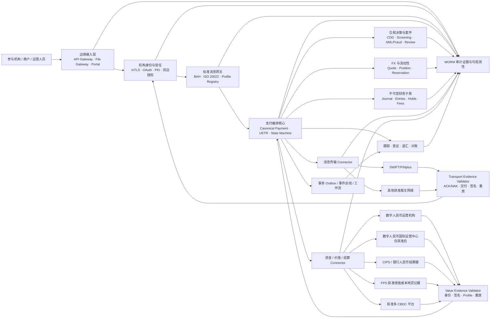
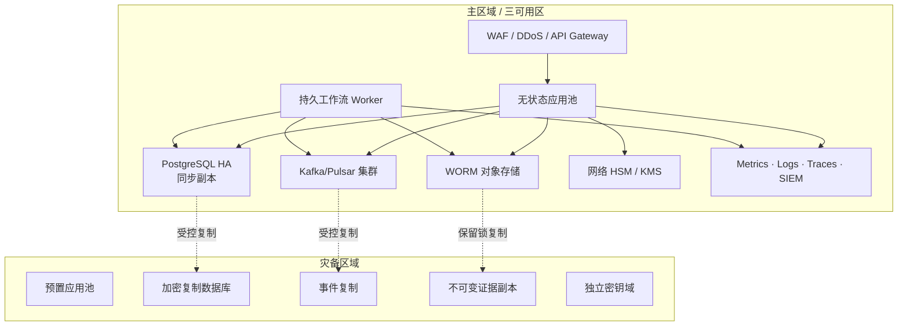
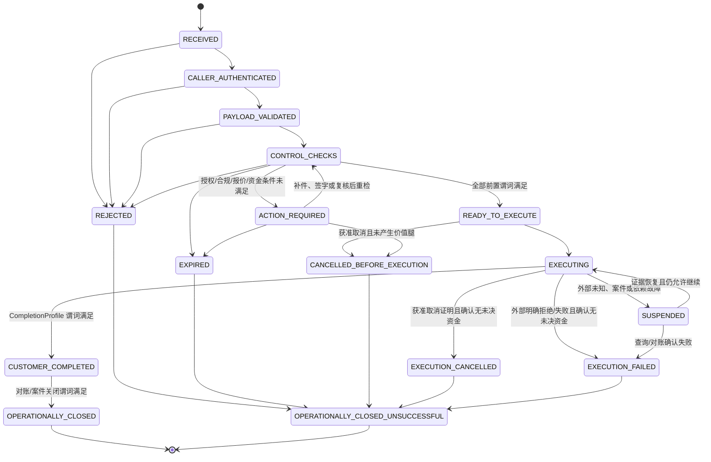
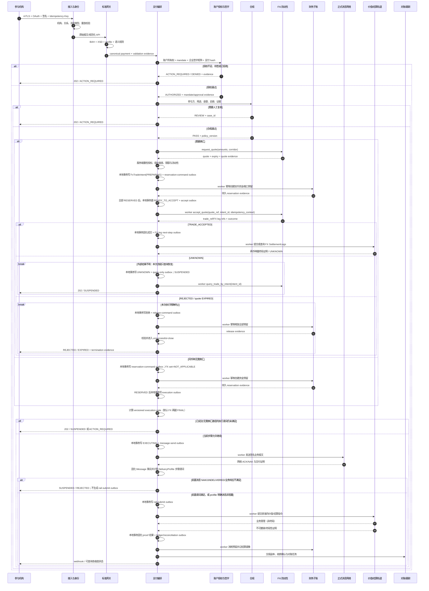
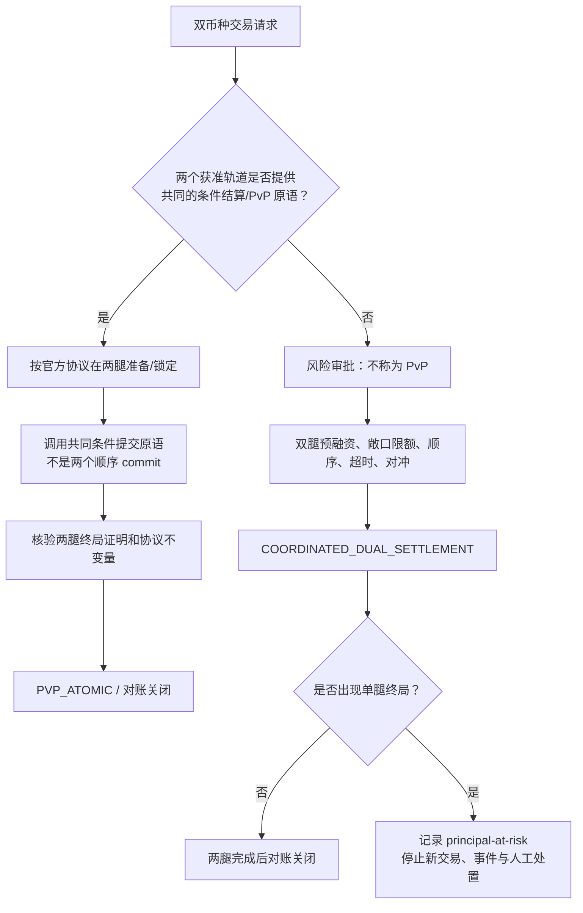
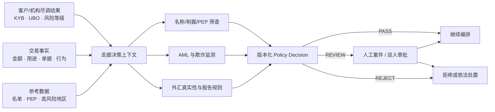

# 生产级数字人民币跨境支付交换平台：改造方案与开发计划

| 项目 | 内容 |
|---|---|
| 文档状态 | **Proposed——须由持牌合作机构、监管合规、法律、安全和运营团队联合评审** |
| 评审基线 | `ea7369c`（v4.0.0 validation） |
| 调研日期 | 2026-07-24 |
| 目标读者 | 产品、架构、支付领域、合规、信息安全、SRE、测试、运营及合作机构 |
| 生产约束 | 未完成本文件的准入门、外部认证和实盘演练前，系统不得接触真实资金或生产敏感数据 |
| 文档关系 | 本文取代 `docs/DESIGN.md` 中面向生产的设想；原文和现有实现继续作为研究沙箱的历史基线 |

> 本文是产品与工程方案，不是法律意见，也不构成任何机构已经批准本项目接入数字人民币、CIPS、SWIFT、FPS 或 mBridge 的陈述。具体牌照、跨境人民币、外汇、反洗钱、数据跨境和清算安排，必须由拟运营主体的持牌机构、法律顾问及主管机关逐项确认。

## 阅读导航

- 决策与边界：[执行结论](#1-执行结论) · [事实基线](#2-事实基线与产品边界) · [现状差距](#3-现状审计与差距矩阵) · [设计原则](#4-不可妥协的设计原则)
- 产品与核心设计：[首期范围](#5-目标产品与首期范围) · [目标架构](#6-目标逻辑架构) · [领域模型](#7-核心领域模型) · [状态机](#8-支付状态机与最终性) · [业务流程](#9-关键业务流程) · [API](#10-对外-api-契约)
- 生产控制：[标准治理](#11-iso-20022-与标准治理) · [合规/数据](#12-合规外汇和数据治理) · [安全](#13-身份信任与安全架构) · [Connector](#14-外部轨道与-connector-设计) · [SRE](#15-可靠性可观测性和运营) · [测试](#16-测试认证与发布门禁)
- 落地计划：[迁移策略](#17-从当前仓库迁移的实施策略) · [Epic](#18-epic-级开发清单与验收) · [前 90 天](#19-前-90-天执行计划) · [配套文档](#20-必须配套的开发文档) · [风险/准入](#21-风险登记与-gono-go) · [仓库顺序](#22-当前仓库的具体改造顺序) · [ADR](#23-架构决策记录adr队列)
- 依据与结论：[官方资料](#24-官方资料与可追溯依据) · [最终判断](#25-最终判断)

## 术语与缩略语

| 术语 | 本文含义 |
|---|---|
| e-CNY | 数字人民币；本文以 2026-01-01 起实施的 2.0 运营框架为当前基线 |
| CBPR+ | SWIFT 跨境支付与报告 ISO 20022 社区使用规则，不是另一套通用 XML |
| BAH | ISO 20022 Business Application Header，承载业务消息级路由/身份元数据 |
| UETR | Unique End-to-end Transaction Reference，端到端支付关联标识 |
| RMA-like | 类似 SWIFT Relationship Management Application 的双边消息关系授权；不是法律上的 SWIFT RMA |
| CIPS | 人民币跨境支付系统；其银行人民币腿不自动等于数字人民币钱包终局 |
| PvP | Payment versus Payment；本文只在正式轨道提供共同条件结算原语时使用“原子 PvP” |
| CDD/KYB/UBO | 客户尽调、机构尽调、受益所有人 |
| HSM/WORM | 硬件安全模块；Write Once Read Many 不可变证据存储 |
| STP | Straight-through Processing，直通式处理 |
| RPO/RTO | 可容忍数据丢失点目标；恢复时间目标，必须按故障域说明 |
| LiabilityProfile | 运营机构负债、计息、存保、准备金/保证金和法域配置 |
| FinalityProfile | 某一正式价值轨道的受理、不可撤销、终局事件及证明规则 |
| CompletionProfile | 聚合客户完成和运营关闭所需的多维谓词 |

---

## 1. 执行结论

当前 `00SWIFT` 是一个结构清晰、可演示支付概念的**研究沙箱**，并不是可以通过“补几个接口、换 PostgreSQL、上 Kubernetes”升级成生产系统的支付基础设施。它已经具备 UETR、支付生命周期、幂等、outbox、字段血缘、双录记账、策略决策等正确概念；但身份信任、标准合规、资金账本、外部结算终局性、合规控制、并发一致性、密钥管理、审计证据和多活运维仍是模拟或单机实现。

本项目不应宣称“复制 SWIFT”或自行成为“数字人民币清算网络”。推荐产品定位是：

> **由持牌银行或获准机构运营的数字人民币跨境支付交换与编排平台**：为参与机构提供身份信任、ISO 20022 消息交换、端到端交易编排、合规决策、外汇与流动性协调、外部结算适配、跟踪查证、对账和运营证据；数字人民币规则、技术标准和央行端基础设施由人民银行负责，客户钱包的负债、计息和运营责任按数字人民币 2.0 的运营机构类型确定，实际价值转移和最终结算只通过获准的数字人民币运营机构、CIPS/银行账户体系、FPS 或其他正式接入的结算基础设施完成。

这一区分是产品成败的前提：

- **SWIFT/FINplus**解决受治理的安全消息传输、标准、身份关系与交易协同，本身通常不是资金账本。
- **CIPS**是受监管的人民币跨境支付清算基础设施，不是可以靠本地数据库模拟后直接替代的“双边通道”。
- **数字人民币**自 2026-01-01 已进入数字存款货币 2.0 框架：人民银行负责规则、技术标准和相关基础设施；商业银行实名钱包余额具有商业银行存款负债属性并计息、纳入存款保险和准备金基数；非银行运营机构负债适用 100% 数字人民币保证金。平台不能自行铸币，也不能把内部余额冒充任何一家正式运营机构的数字人民币负债（见 C08—C09）。
- **mBridge**公开材料可用于研究多 CBDC 架构，但生产接入、节点资格、法域终局性和规则手册必须由项目方正式批准，不能以本地“原子兑换”替代（见 C04—C07）。

建议从**中国内地—香港、单一持牌牵头行/数字人民币运营机构、单一明确业务场景、影子运行后小额受控试点**起步。香港现有公开数字人民币安排仍是试点，且公开的四类钱包主要面向零售商户支付、存在限额并不支持个人间转账；这些限制不能被硬编码为所有市场的钱包规则，也不能被误读为本项目已获 B2B 接入资格（见 C03）。

### 1.1 需要保留、重写和删除的边界

| 处理 | 当前能力 | 决策 |
|---|---|---|
| 保留概念、重写实现 | UETR、消息/资金/结算状态分离、交易副本与字段血缘、幂等、outbox、工作流、双录分录、策略版本 | 这些是生产架构的正确骨架 |
| 仅保留为模拟器 | 本地 CIPS、mBridge、数字人民币铸造/销毁、固定汇率、假证书/CA、沙箱参与者目录 | 移入显式 `/sim` 边界，不得出现在生产部署包 |
| 必须替换 | SQLite、软关联无外键、进程内定时器、静态管理员令牌、调用方自报角色、本地 Fernet/HMAC 密钥、手写 ISO XML | 分阶段替换为生产级基础能力 |
| 必须纠正 | “三级钱包不可追踪”“本地跨币记账即原子 PvP”“ISO XSD 缺失则通过”“本地余额即结算完成” | 属于生产风险，P0 阶段即禁止 |

---

## 2. 事实基线与产品边界

### 2.1 “对标 SWIFT”实际需要对标什么

对标对象不是一个 API 或消息页面，而是由以下能力共同组成的制度化网络：

1. **受治理的参与者准入**：机构身份核验、合同、服务资格、连接认证、关系授权和持续审查。
2. **安全网络与身份信任**：机构级证书、双向认证、密钥仪式、权限分离、异常检测及事件协作。
3. **精确且持续演进的标准**：ISO 20022 报文、Business Application Header、社区使用规则、市场实践和年度版本切换。
4. **端到端交易上下文**：UETR、完整交易副本、合法字段变化、状态确认、退汇和查证。
5. **双边关系控制**：类似 RMA 的“谁可以给谁发送哪类消息”，而不只是网络可达。
6. **高韧性运营**：容量、灾备、网络分区、网络安全恢复、不可抵赖证据、全天候值守。
7. **生态治理**：参与者规则、责任分界、争议机制、版本窗口、测试与认证。

SWIFT 已于 2025-11-22 结束跨境支付指令的 MT/ISO 20022 共存期；SR2026 又引入结构化/混合地址、BAH/消息标识等变化（见 S04—S07）。因而“能生成 pacs.008”不是合规结论，系统必须证明它符合**指定社区、指定报文、指定版本和指定业务场景**的完整使用规则；ISO 官方也不设一个可替代社区验收的统一“ISO 20022 认证机构”（见 S03）。

### 2.2 数字人民币 2.0 的现行负债与运营模型

2021 白皮书记录的是现金型数字人民币 1.0 的设计基线。自 2026-01-01 起，新一代计量框架、管理体系、运行机制和生态体系已经实施，生产设计必须以 2.0 为当前基线，不能继续把所有钱包余额统一描述为“不计息的央行负债/M0”（见 C01、C08—C09）。

| 对象 | 2.0 当前口径 | 对系统的直接要求 |
|---|---|---|
| 人民银行 | 制定业务规则和技术标准，规划、建设并运营相关央行端基础设施，实施监管 | 保存央行规则/标准版本和正式基础设施证明，不自行扮演央行节点 |
| 商业银行运营机构 | 客户实名钱包余额为以账户为基础的商业银行存款负债；按适用存款利率规则计息，纳入银行资产负债管理、存款保险和准备金交存基数 | 识别具体负债银行；支持利息入账/对账、存保适用性、准备金和监管报告责任 |
| 非银行支付运营机构 | 客户数字人民币属于该非银行支付机构负债，实施 100% 数字人民币保证金监管 | 记录保证金/托管银行和对账证据；不得误标为银行存款或默认享有同一存保安排 |
| 非实名/特殊钱包 | 是否计息、限额、功能和匿名程度由当前运营规则决定；当前权威政策解读明确一至三类实名钱包计息、四类钱包不计息（见 C10） | 规则按钱包类型、运营机构、法域和生效日配置，禁止把当前分类硬编码成永不变化的全局模型 |
| 跨境钱包/结算腿 | 境内 2.0 属性不自动决定香港或其他法域的法律分类、存保和终局性 | 每条走廊由法律意见、运营协议和 `LiabilityProfile`/`FinalityProfile` 单独确认 |

因此，领域模型中的“币种都是 CNY”远远不够。每个钱包和结算腿还必须记录**谁是负债主体、运营机构类型、利息权利、存款保险适用性、准备金/保证金处理、法域和有效期**。若本平台只是编排层，权威计息和监管会计仍在运营机构；平台只摄取、核验和对账正式结果。只有平台被正式纳入运营机构核心系统范围时，才可依据受控规则实现相应会计功能。

### 2.3 各网络和账本的责任边界

| 能力层 | 本平台负责 | 外部正式基础设施负责 |
|---|---|---|
| 客户/机构接入 | API、文件、门户、证书绑定、参与者授权 | 合作机构开户、客户关系及法定身份责任 |
| 消息 | 规范化、验证、路由、签名、跟踪、查证 | SWIFT/FINplus、CIPS 等正式网络的传输和网络级回执 |
| 合规 | 规则编排、筛查集成、证据和人工案件 | 持牌机构作最终合规决定并履行报告义务 |
| 资金 | 生成可审计的资金预留和结算指令；维护平台授权的内部子账及外部负债镜像 | 对应商业银行/非银行运营机构的权威数字人民币账本、央行端基础设施、银行账户、CIPS/FPS 等完成实际价值转移 |
| 结算终局性 | 保存并验证外部终局性证明，驱动后续状态 | 由适用法、规则手册和正式结算系统确定 |
| 外汇/流动性 | 报价、限额、头寸和预留编排 | 持牌做市/银行成交并承担头寸与资金义务 |

### 2.4 本方案的监管和运营假设

以下是假设，不是已取得的授权。任一假设不成立时，必须调整范围：

- 产品由持牌银行、数字人民币获准运营机构或其受监管技术服务实体主导；`00SWIFT` 团队不自行吸收客户资金或发行数字人民币。
- 首期必须明确运营机构属于商业银行还是非银行支付机构，并据此确定负债主体、计息、存款保险、准备金/保证金和报表责任；不得沿用一个通用“央行钱包余额”模型。
- 首期只支持一个经合作方批准的内地—香港场景；零售受理、跨境汇款、B2B 贸易支付和机构间结算是不同产品，不能共用一套未经审批的规则。
- 外部网络只通过官方合同、正式技术规范、测试环境和认证接入。拿不到正式资料时只能开发接口契约和模拟器。
- 所有数据落点、跨境字段、监管报送和支持人员访问均按法域、数据分类和最小必要原则设计。
- 平台的“成功”不是本地状态变为 `SETTLED`，而是获得并核验适用外部系统的终局性证据，且支付、报文、子账、外部账单和机构 GL 可完整勾稽。

### 2.5 CN–HK 双法域 discovery gate

香港公开 e-CNY 试点页面只说明消费者试点功能，不授予本项目银行、储值支付工具（SVF）、零售支付系统或跨境汇款资格。首期场景必须由香港法律顾问、HK 合规负责人和实际合作机构完成适用性矩阵（见 H01—H05）：

| 主题 | 香港侧必须回答 | 内地侧必须回答 | 必交证据 |
|---|---|---|---|
| 经营/支付资格 | 运营主体是认可机构、视为/持牌 SVF、技术外包商、商户收单方还是其他角色；PSSVFO/Banking Ordinance 是否适用 | 银行/运营机构/支付机构/技术服务边界及跨境人民币、外汇资格 | 双方法律意见、牌照/豁免/合作协议、资金流图 |
| AML/CFT/制裁 | AMLO、HKMA AI 或 SVF 指引、名单和 STR 责任如何分工 | 反洗钱法、CDD、数字人民币监测/报告及外汇真实性责任 | 控制映射、MLRO RACI、报告和禁止泄密流程 |
| 隐私/数据 | PDPO data user/processor、用途、通知、保留、跨境传输和事件责任 | PIPL/DSL、重要数据、出境机制、数据本地化/评估 | 双向数据流、PIA、合同/评估、字段最小化清单 |
| 操作/网络韧性 | HKMA OR-2、C-RAF、关键基础设施、外包和事件通知是否适用 | 等保、关键信息基础设施、商用密码/密评、人行业务领域数据/网络安全事件规则是否适用 | 双法域控制矩阵、适用性签字、演练和报告手册 |
| 客户/商户保护 | 费用/FX/到账信息、未授权交易、退款、投诉、错误处理和客户资金保障 | 消费者保护、账户/钱包责任、投诉及纠纷安排 | T&C、披露、投诉 SLA、赔付/损失分担规则 |
| 结算终局性 | FPS/本地账户/商户入账的法律与技术含义 | 运营机构钱包/CIPS/银行腿的终局含义 | 每腿 `LiabilityProfile`、`FinalityProfile` 和法律引用 |

总纲不预判上述制度全部适用，也不指定未经评审的密码算法/保护等级。**任何一侧的经营资格、资金责任、数据机制或终局性未签字，只能运行 sandbox/shadow。**

---

## 3. 现状审计与差距矩阵

### 3.1 可复用的基础

代码已具备以下研究价值：

- 支付状态机、UETR、pacs/camt 报文族和消息/价值/结算分层意识。
- `TransactionCopy`、`FieldLineage` 对完整交易上下文和字段变更的建模。
- `IdempotencyRecord`、`OutboxEvent`、`WorkflowInstance` 等可靠处理模式的雏形。
- 金额以整数最小货币单位表达，避免了 UI 直接用二进制浮点记账。
- 数字人民币子系统采用借贷分录思想，而非只记一列余额。
- 标准配置、策略决策、哈希审计等“版本化证据”概念。
- CI 已覆盖 Python/前端测试、静态检查、依赖审计、CodeQL、迁移回转和容器冒烟。

这些代码适合作为需求样例和测试夹具，不应直接成为生产核心的实现包。

### 3.2 关键证据

| 领域 | 仓库证据 | 生产影响 |
|---|---|---|
| 产品声明 | `README.md:24` 和 `backend/main.py:1-4` 明确为独立研究沙箱 | 正确且必须继续保留；`pilot/live` 配置名不得被理解为生产资格 |
| 外部连接 | `backend/config.py:108-139` 只校验 host 配置，`backend/api/swiftref/router.py:6` 明示转发尚未实现；仓库没有贯穿支付的真实 connector | 配成 `live` 仍可能只操作本地模拟数据，容易产生“已接生产”的错误判断 |
| 数据库 | `backend/database.py:15-16` 明示无外键、软关联、单用户；默认 SQLite，启动时 `create_all` | 不能保证引用完整性、并发一致性、可控迁移和 HA |
| 运行时 | `backend/main.py:43-74` 在应用进程内初始化、播种数据并启动清理线程 | 多副本下重复执行，无法可靠选主、重试和观测 |
| 身份权限 | `backend/auth/dependencies.py:53-67` 支持 `swift.api` 通配权限；沙箱可禁用管理认证 | 权限过宽，无法建立参与者、操作者、服务身份和双人复核 |
| UI 信任 | `X-User-Role`/`X-User-Subject` 由请求方提供 | 调用方可以伪造角色/主体，生产必须从已验证令牌和目录派生 |
| 授权热点 | `backend/nextgen/router.py:176-192` 的 outbox 写接口无身份依赖；`backend/api/gpi/router.py:18-105` 未落实注释中的 scope；`backend/api/messaging/service.py:56-74` 查询未按参与者隔离 | 越权写入、查看全局消息或调用不属于本机构的能力 |
| 资金所有权 | `backend/api/ecny/router.py:103-132,248-266` 主要按传入 wallet ID 查询，未把 credential、participant、owner 贯穿授权 | 拥有接口 scope 不应等于可操作任意钱包 |
| 审计 | `backend/core/middleware.py` 仅覆盖部分旧路由，另开事务写审计，失败只记日志 | NextGen 路由缺口；业务成功但审计失败仍放行，不满足完整证据链 |
| 幂等/outbox | `backend/nextgen/runtime.py` 用普通查询认领，冲突时 `rollback()`，无真实 broker worker | 并发会重复领取或回滚外层事务，无法证明业务“恰好一次” |
| e-CNY 账本 | `backend/ecny/ledger/engine.py` 读余额后修改，无行锁或版本条件 | 并发双花/透支风险；余额、分录和外部负债没有正式对账边界 |
| e-CNY 属性 | 当前 wallet/mint/burn 模型按现金型 1.0 思路模拟，缺运营机构负债主体、实名钱包计息、存保、准备金/100% 保证金 | 与 2026-01-01 生效的 2.0 运营模型不符，不能作为权威钱包账本 |
| 合规 | `backend/ecny/compliance/service.py:25-96` 仅阈值规则，且声称三级钱包“不可追踪” | 缺 CDD/KYB/UBO、制裁、PEP、反洗钱监测、案件和法定报告；表述错误 |
| mBridge | `backend/ecny/bridge/mbridge.py:27-49` 使用固定沙箱汇率，本地换汇被标为原子 PvP | 没有真实节点、双腿资金锁定、法域终局性或失败恢复 |
| ISO 20022 | `backend/nextgen/standards.py:252-277` 构造自定义 `ISO20022Envelope`；`validators.py:41-47` 缺 XSD 时跳过并返回成功 | 报文不具备社区合规性；验证 fail-open |
| CIPS | 本地表直接改变参与者余额并计算模拟路由 | 不能代表 CIPS 账户、流动性、排队、日终和正式回执 |
| 部署 | Compose 仅单应用和 SQLite volume，镜像运行单 Uvicorn | 无数据库集群、消息系统、HSM、WORM、跨可用区和灾备 |
| 测试 | 主要使用内存 SQLite 和固定样例 | 缺并发、属性、标准一致性、外部契约、性能、故障注入、灾备和业务认证 |
| 供应链 | 前端无锁文件且镜像使用 `npm install`，Python 多为版本范围 | 构建不可完全复现，缺 SBOM、制品签名、provenance 和许可证门禁 |

### 3.3 优先级

| 等级 | 含义 | 必须完成的主题 |
|---|---|---|
| P0 阻断上线 | 缺失会造成未授权交易、错账、合规违法或虚假终局性 | 产品边界、真实身份、双边授权、不可变账本、外部终局性、合规案件、精确标准、HSM、审计、对账、DR |
| P1 试点前 | 缺失会造成规模化故障或无法运营 | 工作流/outbox、流动性、费率、可观测性、容量、运营门户、查证退汇、数据跨境控制 |
| P2 扩展前 | 首个单走廊可有限人工补偿，但规模化必须具备 | 多走廊、多币种、多活优化、自助接入、智能路由、高级反欺诈、分析 |

---

## 4. 不可妥协的设计原则

1. **报文、资金和结算终局性分离。** 收到成功回执不等于资金结算；内部记账不等于正式运营机构钱包负债、保证金/准备金或外部结算账户已经移动。
2. **外部证据驱动终局状态。** 每个 `SettlementLeg.state=FINAL` 只能由经过签名/认证、满足正式规则的外部证明触发；支付投影只有在全部 required legs 满足 profile 谓词后才可显示结算完成，人工操作不得直接写入。
3. **2.0 双层运营和中介合规。** 人民银行规则/基础设施、商业银行存款负债、非银行运营机构负债与保证金、客户服务和合规责任进入领域模型；平台不暴露公共 `mint`，不自行扮演央行或运营机构核心账本。
4. **完整双录、余额派生。** 日记账和分录不可变；余额是可重建投影，不是可随意更新的事实源。
5. **业务恰好一次，不承诺网络恰好一次。** 用参与者范围内幂等键、数据库约束、事务 outbox、可重复消费和对账实现；任何网络均按可能重复、乱序、延迟处理。
6. **标准精确到版本和社区。** 不存在笼统的“ISO 20022 认证”；必须声明并验证 message definition、BAH、社区 profile、有效期和业务规则。
7. **验证和合规失败关闭。** 缺 XSD、规则包、筛查服务或签名验证时进入隔离/待处理，绝不能当作通过。
8. **最小数据和合法可追溯并存。** “可控匿名”是小额场景的数据最小化与分权访问，不是免 KYC、不可追踪或规避 AML。
9. **参与者隔离与关系授权。** 网络连通不等于可发消息；每个机构、证书、账户、报文类型和业务目的均受关系矩阵约束。
10. **双人复核与职责分离。** 参与者启停、限额、规则发布、密钥、人工放行、账务调整和灾备切换均需 maker-checker。
11. **模拟器物理隔离。** `/sim` 包、测试证书和种子机构不得进入生产制品，CI 要对其做负面扫描。
12. **先可证明，再自动化。** 每次决策必须能重放输入、规则版本、操作者、外部证据及输出。

---

## 5. 目标产品与首期范围

### 5.1 产品模块

| 模块 | 首期能力 | 明确不做 |
|---|---|---|
| Participant Hub | 机构准入工作流、证书/服务身份、双边关系、消息类型授权、限额 | 不替代合作机构法定准入 |
| Payment Exchange | API/文件接入、UETR、规范化、路由、状态、通知 | 不把 API 受理等同于结算 |
| Standards Gateway | BAH、ISO 20022 XSD/语义/profile 校验、版本切换 | 不创造未经社区允许的私有 XML |
| Compliance Hub | CDD 结果引用、制裁/PEP/欺诈/AML 编排、人工案件、证据 | 不允许客户请求决定自身策略 |
| FX & Liquidity | 报价、有效期、费用披露、头寸和资金预留 | 不无牌做市、不用硬编码汇率 |
| Settlement Orchestrator | 通过正式适配器提交、查询、确认、退回、对账 | 不在本地伪造 CIPS/e-CNY/mBridge 终局性 |
| Financial Ledger | 平台授权范围内的预留、费用、利息镜像、应收应付和结算镜像双录 | 不将内部账本称为运营机构数字人民币权威负债账本 |
| Tracking & Cases | 端到端跟踪、查证、退汇、撤销、异常对账、SLA | 不允许删改历史 |
| Operations & Evidence | 四眼操作、审计、证据包、监控、容量、灾备 | 不以普通应用日志替代审计 |

### 5.2 首期业务建议

先选一个场景，不同时做“个人钱包汇款 + B2B 贸易 + 机构间多 CBDC”：

**推荐试点：持牌合作机构主导的内地—香港跨境收款/付款编排，先影子运行，再在正式许可范围内小额实盘。**

业务规格必须在合作方确定后冻结：

- 付款人与收款人的客户类型（个人、商户、企业或金融机构）。
- 数字人民币在哪一侧作为付款资产、收款资产或仅作为受理工具。
- 外汇兑换主体、成交时间、汇差与费用承担。
- 结算账户/钱包的法律所有人和备付/头寸安排。
- 每个环节的 AML、外汇、贸易背景和数据控制责任。
- 哪个外部事件构成不可撤销终局性。
- 退汇、撤销、错账、制裁命中和断网时的资金处置。

### 5.3 首期不在承诺范围

- 自行发行、铸造或销毁数字人民币。
- 未获准成为 CIPS 直接/间接参与者、数字人民币运营机构或 mBridge 节点。
- 用内部 token 冒充官方数字人民币或运营机构负债并向公众销售。
- 跨法域“天然原子”的 PvP；只有两侧规则和法律终局性均确认后才能使用“原子”表述。
- 全匿名跨境钱包、绕过客户尽调或监管报告。
- 在没有正式 community profile 和测试材料时声称通过 SWIFT/CBPR+ 或 CIPS 认证。

### 5.4 Network/Participant Rulebook

“SWIFT-like” 不只是一组技术接口。多机构试点前必须发布经法律和合作方批准的网络规则手册，至少包括：

- 参与者类别、准入、持续尽调、服务资格、年度复核、暂停和退出。
- 报文传输、客户授权、合规、资金预留、结算、入账、对账和报告的责任边界。
- ACK/交付、业务接受、不可撤销、最终、入账和退回的法律/技术含义及免责声明。
- 服务时间、cut-off、SLA、费用、FX 披露和性能测量方法。
- 错误付款、重复、欺诈、单腿敞口、数据泄露和系统中断的责任、赔偿及损失分担。
- 查证、投诉、争议、证据、仲裁/司法管辖和监管协作。
- 数据用途、保密、跨境传输、留存、监管访问和审计权。
- 年度标准切换、紧急名单/安全/规则变更、兼容窗口和参与者通知。

每个参与者的 `participant_rulebook_acceptances` 记录 rulebook version、服务/走廊、签署法人、签字人、时间、生效/退出日和证据 hash。未接受当前生效版本，网关默认拒绝新交易；紧急暂停和在途交易处置按规则手册执行。

---

## 6. 目标逻辑架构



消息传输与资金/外汇/价值结算能力必须物理和语义分离：SWIFT/FINplus 的网络 ACK、交付通知或对端业务接受是**报文证据**，绝不是资金终局性；CIPS 只证明其被批准的银行人民币结算腿，不能自动证明数字人民币钱包已完成最终扣贷；FPS 的 top-up 或本地贷记也只是其被批准的 funding/credit leg。入站报文先验证 transport evidence、机构身份/双边 entitlement，再经过 BAH/XSD/profile 标准网关；价值证明先经过 connector 身份、签名、重放和 versioned evidence validator，若其承载 ISO 报文还要进入标准网关，之后才能写子聚合事实。聚合支付只有在 `CompletionProfile` 对全部 required child sets 的谓词满足后才可显示完成。

### 6.1 控制面与数据面

**控制面**管理参与者、证书、双边关系、标准包、路由、策略、限额、功能开关和发布审批；所有变更版本化、双人复核、有生效窗口且可回滚。

**数据面**处理真实交易。数据面只能读取已批准且生效的控制面快照，不允许在请求中携带并即时启用策略、汇率、参与者身份或权限。

### 6.2 服务边界

初期不建议立即拆成几十个微服务。采用**模块化单体 + 独立高风险服务**：

- 支付编排、标准转换、案件和查询可先在一个部署单元内保持清晰模块边界。
- 财务账本、身份/密钥、合规连接器、外部结算适配器和审计证据应独立进程/权限/数据库角色。
- 事件总线只传递事件，不作为金融事实源。
- 当吞吐、团队或监管隔离要求明确后，再按领域和一致性边界拆分。

跨进程不存在“神奇的同一事务”。事务和事实 owner 必须固定：

- 支付编排库负责 `PaymentOrder/FxTradeIntent`、workflow state、inbox/outbox 和已接收证据引用的本地 ACID 提交。
- 财务账本库负责 hold/reservation、journal/entry 和自身 outbox 的本地 ACID 提交；外部资金方只由 `FundingConnector` 的已验证证明代表。
- 外部成交、报文和结算事实分别由对应 connector 的回执、查询、账单和 proof validator 代表。
- 跨边界使用持久 saga barrier：编排器先提交意图与 reservation-command outbox；账本/资金方幂等预留并返回持久证据；编排器确认**全部** required reservations 为 `RESERVED` 后，才在自己的单一事务中把意图置为 `READY_TO_ACCEPT` 并写 accept-quote outbox。任何缺失、拒绝或 `UNKNOWN` 都不得越过 barrier。这里不使用 XA/分布式两阶段提交，也不把事件总线当作提交证明。

### 6.3 生产部署拓扑



该拓扑按每个获准的 data-residency zone 分别部署。主区和 DR 默认位于同一获准法域；图中的数据库、事件和 WORM 复制不表示可把大陆全量生产库直接复制到香港或反向复制。跨法域只通过最小字段网关交换已批准的业务消息；若确需跨境灾备/全量复制，必须另有数据分类、合法机制、安全评估、接收方和监管签字后才能设计。

生产最低要求：

- PostgreSQL 或经批准的等价 ACID 数据库；同步高可用、PITR、校验备份、独立灾备，不允许 SQLite。
- Kafka/Pulsar 等持久消息系统，配 schema registry、ACL、配额、死信隔离和可重放策略。
- HSM 保管机构私钥、签名密钥和高价值数据密钥；应用不得读取明文私钥。
- 对象锁/WORM 保存报文原件、签名、标准包、审批、对账和案件证据。
- 容器平台至少跨三个故障域，默认拒绝网络策略、不可变镜像、工作负载身份和准入策略。
- 开发、预生产、合作方认证、沙箱与生产信任域（含 DR）严格分离，证书、密钥和生产数据不得跨这些环境复用。
- DR 属于生产信任域但使用独立故障域和受控管理域：数据/证据按批准机制加密复制；签名连续性采用 HSM 厂商支持且经密钥仪式批准的安全复制/备份，或合作方预注册的独立 DR 证书，绝不复制明文私钥文件。切换、回切、证书启用和外部 allowlist 变更均双控并演练。

---

## 7. 核心领域模型

### 7.1 聚合与表

| 聚合 | 关键表 | 核心约束 |
|---|---|---|
| 参与者 | `participants`, `participant_services`, `participant_relationships`, `entitlements`, `participant_limits`, `participant_rulebook_acceptances` | 法人/服务状态有有效期；双边关系约束消息族、方向、币种、走廊；须接受当前规则手册 |
| 身份与密钥 | `service_identities`, `certificates`, `key_references`, `operator_identities`, `role_bindings` | 私钥只存 HSM reference；证书序列号/issuer 唯一；不得信任请求头角色 |
| 客户/对手方 | `parties`, `party_identifiers`, `accounts`, `wallet_aliases`, `consents` | PII token 化；法域与控制者标识；别名不能替代法定客户记录 |
| 支付授权 | `account_mandates`, `signatory_policies`, `payment_authorizations`, `approval_records` | 授权绑定付款账户、支付 hash、金额/币种/用途/期限；调用者身份不能替代扣款权 |
| e-CNY 负债配置 | `ecny_operators`, `liability_profiles`, `wallet_profiles`, `interest_rate_versions`, `interest_postings`, `reserve_or_guarantee_reports` | 明确银行/非银行负债主体、计息/存保/准备金或保证金、法域和有效期 |
| 支付 | `payment_orders`, `payment_instructions`, `payment_parties`, `payment_amounts`, `payment_charges` | UETR 唯一；原始请求不可变；修订生成新版本 |
| 报文 | `messages`, `message_payloads`, `message_validations`, `transaction_copies`, `field_lineage` | 原文 hash/签名/标准版本不可变；同一外部 message ID 去重 |
| 合规 | `screening_runs`, `screening_hits`, `policy_decisions`, `compliance_cases`, `case_evidence` | 决策记录输入摘要、模型/规则版本、提供方和人工审批 |
| FX/流动性 | `fx_quotes`, `fx_trade_intents`, `fx_trades`, `positions`, `liquidity_limits`, `liquidity_reservations` | 报价有到期时间；接受意图幂等；法律成交事实不可回写；预留有所有者和释放原因 |
| 结算 | `settlement_instructions`, `settlement_legs`, `settlement_attempts`, `settlement_proofs` | 外部引用唯一；终局证明原件不可变；支付腿和 FX 买入/卖出腿分别建模 |
| 账本 | `ledger_legal_entities`, `ledger_books`, `ledger_accounts`, `journals`, `journal_entries`, `holds`, `balance_snapshots`, `gl_mappings`, `gl_export_batches` | 每一 journal 绑定 legal entity/book/business date 且借贷平衡；entry 只追加；余额可重建并桥接机构 GL |
| 可靠交付 | `idempotency_keys`, `outbox_events`, `inbox_messages`, `subscriptions`, `webhook_deliveries` | `(participant_id, operation, idempotency_key)` 唯一；payload hash 不同则 409 |
| 运营 | `investigations`, `returns`, `cancellations`, `reconciliation_runs`, `reconciliation_breaks` | 所有人工更改有理由、证据、maker/checker |
| 审计 | `audit_events`, `evidence_manifests`, `access_decisions` | 哈希链 + WORM；业务、管理、数据读取均覆盖 |

### 7.2 金额和时间规则

- 禁止 `float`。API 金额使用十进制字符串，例如 `"1250.35"`；入账转换为最小货币单位整数，或数据库 `NUMERIC(38, n)`，`n` 来自版本化货币元数据。
- 金额必须同时携带币种，禁止在不同币种之间直接借贷平衡。FX 交易以两个独立币种腿和明确的汇率/舍入/损益分录表示。
- 利率、计息资格、日计数、结息日、舍入和税务处理不得硬编码；每笔利息记录引用运营机构、钱包 profile、利率版本和有效期。
- 所有服务保存 UTC `timestamptz`，同时保留业务日期、结算日、时区和来源时间；禁止依赖应用服务器本地时钟。
- 所有 ID 使用 UUIDv7/等价有序不可预测 ID；外部 ID 单独保存，不能直接作为内部主键。
- 外键默认强制；只有跨库事件引用可软链接，并须有对账和补偿机制。
- PII、报文原文和大体量证据与交易索引分离存储，按法域、机构、业务日期分区。

### 7.3 财务子账规则

内部子账只记录平台被授权记录的经济事实：

- 客户/参与者资金预留及释放。
- 应付/应收结算腿。
- 手续费、税费、FX 差额及损益。
- 经运营机构正式账单确认的数字人民币利息镜像；若平台属于获准核心记账范围，再按批准的利率版本、计息周期、舍入和税务规则生成权威利息分录。
- 外部结算镜像和调节项。
- 暂记、拒绝、退回和差错处理。

账务维度必须显式：

- 每个 account 属于一个 legal entity、book、branch/成本中心、币种、科目和会计用途；禁止跨法人用一个“平台总余额”抵消。
- 跨法人业务使用分别平衡、相互引用的 due-to/due-from journals 和正式 intercompany 对账，不在单 journal 中混平。
- business date、营业日历、open/soft-close/hard-close 期间、日终试算和关账证据；已关期间只能按批准流程在当前期间调整或受控重开。
- suspense、manual adjustment、fee、tax、interest accrual、FX revaluation/realised P&L 使用独立科目和 reason code，人工分录四眼审批。
- `payment → subledger journal → settlement/funding statement/proof → institution GL` 四方对账。GL bridge 有批次 hash、科目映射版本、借贷总额、接收 ACK、拒绝和重送，不能只导出 CSV 后视为完成。
- 内部 operational subledger、运营机构权威钱包账和法人总账的 owner、SLA 和差异处理分别定义。

每个 journal 必须满足：

```text
同一币种：Σ debit = Σ credit
同一法人/账簿：journal 不跨 legal entity 或 book 平衡
期间有效：business date 位于允许过账期间，关账后不得回写
不可变：posted journal 不更新、不删除，只能用 reversal journal 冲销
可追溯：journal -> payment -> settlement leg -> external proof
可重建：任意时点余额 = 期初 + 截止该时点全部有效分录
```

默认情况下，数字人民币权威负债不属于本平台账本：商业银行钱包负债属于具体商业银行，非银行运营机构钱包负债属于具体非银行机构并受 100% 数字人民币保证金监管。平台必须把内部 ledger 标为 orchestration/subledger mirror，并与运营机构的余额、利息、准备金/保证金及结算账单对账。只有部署在获准运营机构核心系统内、责任和会计规范明确、正式认证通过后，某一账本组件才可承担该机构授权范围内的权威记账；这不能由代码团队自行假设。

---

## 8. 支付状态机与最终性

### 8.1 不使用单一 `status`

每笔 `PaymentOrder` 维护一个**编排意图状态**，并关联至少九类子聚合/事实集合；这些不是 payment 行上的若干可覆盖单值。编排状态只说明平台正在做什么，不能覆盖外部事实：

| 子聚合/事实 | 单个对象的示例状态 | 权威来源 |
|---|---|---|
| `Message[*].state` | `RECEIVED`, `VALID`, `NETWORK_ACKED`, `NAK_RECEIVED`, `DELIVERED`, `UNDELIVERED` | 消息网关和外部网络回执 |
| `AuthorizationWorkflow/Decision[*]` | `PENDING`, `MANDATE_VERIFIED`, `SIGNATURES_PENDING`, `AUTHORIZED`, `DENIED`, `EXPIRED` | 账户所有权、扣款 mandate、企业签字矩阵和持久批准单 |
| `ComplianceDecision/Case[*]` | `PENDING`, `PASSED`, `REVIEW`, `REJECTED`, `EXPIRED` | 合规策略和案件审批 |
| `FundingReservation[*].state` | `NOT_APPLICABLE`, `PENDING`, `AVAILABLE`, `RESERVED`, `RELEASED`, `CONSUMED`, `REJECTED`, `UNKNOWN` | 财务子账和外部资金方 |
| `FxQuote[*].state` | `REQUESTED`, `QUOTED`, `ACCEPTANCE_REQUESTED`, `EXPIRED`, `REJECTED` | 持牌/获准报价方的报价和有效期证据 |
| `FxTrade[*].contract_state` | `ACCEPTANCE_PENDING`, `TRADE_ACCEPTED`, `UNKNOWN`, `REJECTED`, `TERMINATED` | 独立 FxTrade 聚合和持牌/获准成交方；只表达法律成交状态 |
| `SettlementLeg[*].state` | `NOT_APPLICABLE`, `PENDING`, `NOT_SUBMITTED`, `SUBMITTED`, `ACCEPTED`, `IRREVOCABLE`, `FINAL`, `REJECTED`, `FAILED`, `UNKNOWN` | 价值结算适配器及正式终局性规则；包含支付腿和 FX 两币种腿 |
| `BeneficiaryCredit[*].state` | `UNKNOWN`, `BANK_RECEIVED`, `CREDIT_PENDING`, `CREDITED`, `REJECTED` | 收款机构确认 |
| `ReconciliationRun/Break[*]` | `UNMATCHED`, `MATCHED`, `BREAK`, `RESOLVED` | 支付、子账、外部账单/proof 与机构 GL 多方对账 |

因此，一条 `pacs.008` 已交付而后续 `pacs.002` 被 NAK、结算腿 A 已 `FINAL` 而腿 B 为 `UNKNOWN`，都必须同时保留。payment read model 只保存带 `projection_rule_version` 的计数/摘要和 required child set 结果，可由子事实重建；它不是权威状态源。`CompletionProfile` 对指定的 `required_messages`、`required_funding_reservations`、`required_fx_trades`、`required_settlement_legs`、`required_beneficiary_credits` 和 reconciliation runs 求谓词。

调用方通过 mTLS/OAuth 认证，只能证明“谁发来了请求”，不能证明该主体有权扣某个账户。提交结算前必须在服务端核验账户/钱包所有权、有效 mandate、企业签字矩阵、授权金额/币种/用途/期限和 maker-checker 记录，并将原始签名或外部授权证明纳入 WORM evidence。

对外可以展示派生的客户结果，但必须同时提供精确维度。UI 不得把 `NETWORK_ACKED`、`ACCEPTED`、`FINAL` 和 `CREDITED` 都显示为“到账”。

### 8.2 编排状态与独立事实状态机



`CompletionProfile` 按产品/走廊声明客户结果和运营关闭各自需要哪些谓词。例如，某产品可能要求 `settlement=FINAL + beneficiary=CREDITED` 后向客户显示完成，但只有 `reconciliation=MATCHED` 且无开放案件时才进入 `OPERATIONALLY_CLOSED`。另一轨道的入账和结算先后可以不同。编排器只计算谓词，不得为了推进主状态而伪造任何维度。

失败/取消/过期也不能“直接关闭”。进入 `OPERATIONALLY_CLOSED_UNSUCCESSFUL` 前须证明所有 required child objects 已终态或明确 `NOT_APPLICABLE`、所有 holds 已释放/冲正、外部不存在未知资金动作、对账和案件已完成，并保存不可变 termination reason/evidence。否则继续 `SUSPENDED`。

各子聚合有自己的状态机：

- 消息：`VALID → NETWORK_ACKED/NAK_RECEIVED → DELIVERED/UNDELIVERED`；网络结果不改变结算事实。
- 授权：`PENDING → MANDATE_VERIFIED → SIGNATURES_PENDING/AUTHORIZED/DENIED/EXPIRED`；批准必须绑定支付 hash 和限额。
- FX quote：`REQUESTED → QUOTED → ACCEPTANCE_REQUESTED`，或由报价方证据进入 `EXPIRED/REJECTED`。
- FX trade：`ACCEPTANCE_PENDING → TRADE_ACCEPTED/UNKNOWN/REJECTED`；已接受的合同只有在有法律效力的取消、终止或替代证据时才进入 `TERMINATED`。它不使用 `SETTLED` 冒充价值终局，FX 买入/卖出腿按 `SettlementLeg` 独立推进。
- 结算：`NOT_SUBMITTED → SUBMITTED → ACCEPTED → IRREVOCABLE/FINAL`，超时进入 `UNKNOWN`，经正式查询/账单恢复为 `ACCEPTED/FINAL/FAILED`。
- 收款：`UNKNOWN → BANK_RECEIVED → CREDIT_PENDING/CREDITED/REJECTED`，以收款机构证明为准。
- 对账：`UNMATCHED → MATCHED` 或 `BREAK → RESOLVED → MATCHED`。

撤销和退回不是原支付上的临时状态：

- `CancellationRequest` 是独立聚合，记录 `REQUESTED → VALIDATED → SUBMITTED → ACCEPTED/REJECTED/EXPIRED`。被拒绝时原支付维持其真实状态，不固定“退回 SUBMITTED”。
- `ReturnPayment` 是引用 `original_payment_id/uetr` 的新支付腿，有独立报文、授权、合规、资金、结算和对账状态；原支付保留完整历史。
- 撤销请求与原支付终局性发生竞态时，以外部轨道证明和规则决定结果，进入案件而不是最后写入覆盖。

所有转换必须包含：

- 当前版本的 compare-and-swap 条件，数据库原子更新，不用 Python 先读后比。
- 允许执行转换的参与者角色和双边关系。
- 所需前置决策、审批、资金预留和外部证据。
- 规则编号、原因码、时间、actor、request/message ID。
- 产生的不可变领域事件和 outbox 事件。
- 超时、补偿、人工案件与重试政策。

### 8.3 交付、负债与终局性登记表

每个消息服务上线前完成 `DeliveryProfile`，禁止把网络回执推断成资金结果：

```yaml
transport: <approved-network>
service: <business-service>
profile_version: <version>
ack_event: <network-ack>
nak_event: <network-nak>
delivered_event: <official-delivery-event>
undelivered_event: <official-non-delivery-event>
business_response_semantics: <separate-message-only>
evidence_validator: <versioned-validator>
timeout_policy: <policy-id>
approved_by: [messaging-owner, standards-owner, risk]
effective_from: <timestamp>
```

每个数字人民币 wallet/settlement connector 上线前先完成 `LiabilityProfile`：

```yaml
operator_id: <approved-operator>
operator_type: commercial_bank | non_bank_payment_institution
jurisdiction: CN
wallet_category: <official-category>
liability_obligor: <legal-entity-id>
interest:
  eligible: true | false
  authoritative_source: <operator-ledger>
  rate_rule_reference: <approved-rule>
deposit_insurance:
  applicable: true | false | requires_legal_confirmation
reserve_or_guarantee:
  treatment: reserve_requirement_base | one_hundred_percent_ecny_guarantee
  evidence_source: <statement-or-report>
effective_from: <timestamp>
approved_by: [legal, finance-control, operator-owner]
```

境外/跨境钱包不能复制境内配置；其负债、利息和保障字段应先标为 `requires_legal_confirmation`，在正式条款确认后生效。

每个 connector 上线前必须完成 `FinalityProfile`：

```yaml
rail: <approved-rail-id>
corridor: CN-HK
service: <service-name>
acceptance_event: <official event>
irrevocability_event: <official event>
finality_event: <official event>
evidence_type: signed-message | authenticated-api | statement
evidence_validator: <versioned validator>
timeout_policy: <policy-id>
return_after_finality: <allowed process>
legal_basis_reference: <reviewed rulebook/legal opinion>
approved_by: [legal, settlement-owner, risk]
effective_from: <timestamp>
```

产品再通过 `CompletionProfile` 引用一个或多个 `FinalityProfile`，声明：

```yaml
product: <approved-product>
customer_completed_when:
  authorization_decision:
    immutable_ref: required
    outcome: AUTHORIZED
    bound_payment_hash: required
    valid_at_execution: true
  compliance_decision:
    immutable_ref: required
    outcome: PASSED
    input_hash_and_rule_version: required
    valid_at_submission: true
  required_messages:
    selector: <message-set-profile>
    delivery_profile_refs: required
    predicate: all_delivered_or_business_responded
  required_funding_reservations:
    selector: <funding-set-profile>
    predicate: all_consumed_or_not_applicable
  required_fx_trades:
    selector: <fx-set-profile>
    predicate: all_contracts_accepted_or_not_applicable
  required_settlement_legs:
    selector: <settlement-set-profile>
    finality_profile_refs: required
    predicate: all_final_or_not_applicable
  required_beneficiary_credits:
    selector: <credit-set-profile>
    predicate: all_credited_or_not_applicable
operationally_closed_when:
  required_reconciliation_runs:
    selector: <reconciliation-set-profile>
    predicate: all_matched
  open_cases: 0
```

每个 `selector` 都由已批准的产品/走廊版本解析为确定的子对象集合；空集合只有在 profile 明确声明 `NOT_APPLICABLE` 时才通过，不能因为对象尚未创建而“真空成立”。消息谓词使用与消息实例绑定的 `DeliveryProfile` 判定某类消息需要网络交付、业务响应还是二者之一；它仍不代表资金终局。

当前 `authorization_state`/`compliance_state` 用于工作流展示，不能在交易完成后被改写来反证历史结果。授权和合规 decision 是只追加对象，记录支付 hash、输入 hash、规则/名单版本、签字人、`evaluated_at`、`valid_from/to` 和提交时间。后续 mandate 吊销、名单更新或规则变化应创建 re-screen/case/后续限制，不追溯篡改已发生交易的决策证据。

没有已批准的 `LiabilityProfile` 和 `FinalityProfile`，价值类 connector 只能处于 `simulation` 或不产生资金动作的 `shadow` 模式；没有 `CompletionProfile`，UI 不得显示笼统“完成”。

---

## 9. 关键业务流程

### 9.1 正常跨境支付



关键规则：

- API 返回 `202 Accepted` 只表示平台已接管处理。
- 机构认证不等于扣款授权；没有与支付 hash、金额、币种、用途和有效期绑定的 mandate/签字/批准证据，不得建立资金预留或发出结算指令。
- 客户取消必须在 `irrevocability_event` 前按 connector 规则执行；之后只能走正式退回/退款流程。
- 消息网络 ACK/交付和结算轨道受理分别入账，均不能替代终局性或受益人入账证明。
- `DeliveryProfile` 同时定义消息事实是否是下一价值步骤的前置条件。若要求网络 ACK、交付或业务响应，只有对应谓词满足后才可在本地事务中生成 `rail-submit outbox`；`NAK/UNDELIVERED` 默认挂起或拒绝且不产生孤儿价值腿。只有 profile 事先明确为 `informational/non-blocking` 的消息才可与价值腿并行或不阻断，且该决定须版本化、经风险/运营批准并保留交易级引用。
- FX quote 不是成交。需要换汇时，必须先在服务端重检授权、报价容差、限额和流动性。跨服务不假设 ACID：通过 §6.2 的 saga barrier，先持久化意图和预留命令，取得全部双币资金/敞口的 `RESERVED` 证据后，才由编排器在一个本地事务中写 `READY_TO_ACCEPT + accept outbox`；提交成功后 worker 才能在报价有效期内接受报价。
- `accept_quote` 必须携带稳定 `trade_intent_id` 和 provider-specific `idempotency_context`。若供应商不支持可证明的幂等接受，歧义超时只能 `query_trade_by_intent`、对账和人工恢复，绝不能自动重试；`UNKNOWN` 默认 `SUSPENDED` 且禁止新 value instruction。只有 Rulebook 和风险委员会事先批准、限额内且可审计的显式敞口 profile 才可例外继续。
- `REJECTED` 或 quote `EXPIRED` 时生成释放命令并取得所有 reservation release evidence；在 holds 未释放、外部成交仍可能存在或对账未关闭前，不得进入 unsuccessful close。
- `TRADE_ACCEPTED` 只表达法律成交，不等于 FX 两腿已经终局。FX 买入/卖出腿都是带 `FinalityProfile` 的 `SettlementLeg`；正式证明到达前保持 `PENDING/UNKNOWN`，不能把 `QUOTED` 或成交回执当作价值 `FINAL`。首期默认 profile 要求 FX 两腿 `FINAL` 后才允许发出支付价值腿；并行或先支付的产品必须单独批准本金敞口、预融资、对冲、限额和异常处置。
- 每次外部重试复用相同业务意图，但按外部规则生成/复用 message ID，并记录 attempt。
- 超时不能直接判失败；先进入 `UNKNOWN`，通过查询和对账确认是否已发生资金移动。

### 9.2 退回、撤销与调查

- `camt.055` 是适用 profile 下的客户到银行撤销请求；`camt.056` 是 FI-to-FI 取消请求。二者都不是已取消证明，回复和最终处置分别建模。
- `pacs.004` 表达支付退回，必须引用原支付、原 UETR、退回金额、币种、费用和原因。
- `camt.029` 表达调查/取消处理结果；`camt.110/111` 支持调查请求和响应的场景按适用 profile 启用。
- 已终局支付不删除、不原地改金额；创建关联的 return/reversal 交易和反向分录。
- 收款人信息缺失、制裁名单更新、重复支付、外部状态冲突和账实不符均进入案件队列，案件有 SLA、owner、证据、评论、审批和升级。

### 9.3 条件式 PvP 与协调式双腿结算

通用应用编排器依次向两个独立轨道调用 `commit`，**不能**创造原子 PvP。只有两个轨道共同提供并由正式规则约束的原生条件结算原语，使任一腿都不能在另一腿失败时单独终局，产品才可标记为 `PVP_ATOMIC`：



`COORDINATED_DUAL_SETTLEMENT` 必须显式展示和限制本金风险：

- 最大单笔/累计敞口、最大单腿暴露时间和参与者信用限额。
- 两腿预融资/抵押、提交顺序、流动性缓冲和必要的 FX 对冲。
- 单腿已终局时不得假设可以自动冲正；依据法律/轨道规则执行补腿、退回、对冲或损失处置。
- 网络分区、协调器故障、证明延迟、时钟偏差、参与者违约和法域冲突均进入场景测试。

mBridge 或其他正式多 CBDC 平台若提供获准的原生 PvP，应由该平台规则和证明验证器保证上述条件；本系统只做调用、证据核验和恢复编排。现有单数据库 nested transaction 仍只是模拟器，不能证明跨系统原子性。

### 9.4 幂等、重复和乱序

1. 边缘层对 `(participant_id, operation, idempotency_key)` 建唯一约束。
2. 首次请求原子保存 payload hash、处理资源和响应；相同键相同 payload 返回原响应。
3. 相同键不同 payload 返回 `409 IDEMPOTENCY_CONFLICT` 并产生安全事件。
4. 业务事务与 outbox 在同一数据库事务提交。
5. publisher 可重复发布；消费者以 `event_id + consumer` inbox 唯一约束去重。
6. 每个聚合有 `aggregate_version`；乱序事件暂存、补拉或重放，不覆盖新状态。
7. 外部超时后先查询/对账，不能盲目重发不可幂等的资金指令。

---

## 10. 对外 API 契约

### 10.1 安全基线

- TLS 1.3（兼容性需要时受控支持经批准的 TLS 1.2 套件）和机构 mTLS。
- OAuth 2.0 client credentials；高信任场景使用 `private_key_jwt` 或等价的不可共享凭据。
- token 的 issuer、audience、client、participant、service、scope、走廊和环境均校验。
- 请求签名覆盖 method、path、关键 headers、body digest、时间戳和 nonce；共享防重放存储。
- 机构、用户、角色从受信身份映射得出，禁止 `X-User-Role`、`X-User-Subject` 决定权限。
- 所有写操作要求 `Idempotency-Key`；所有请求有 `X-Request-Id`，平台另生成不可伪造的 correlation ID。
- 签名 webhook、指数退避、事件 ID、序号、补拉 API 和订阅密钥轮换。

### 10.2 创建支付示例

```http
POST /v1/payments
Authorization: Bearer <short-lived-token>
Idempotency-Key: 018f6f1e-...
X-Request-Id: 018f6f20-...
Content-Type: application/json
Content-Digest: sha-256=:<base64-body-digest>:
Signature-Input: sig1=("@method" "@path" "content-digest" "idempotency-key" "x-request-id");created=<unix-time>
Signature: sig1=:<base64-signature>:
```

```json
{
  "instruction_id": "CORP-20260724-000018",
  "requested_execution_date": "2026-07-27",
  "payment_type": "customer_credit_transfer",
  "corridor": "CN-HK",
  "debtor": {
    "party_id": "pty_01...",
    "account_id": "acct_01..."
  },
  "authorization": {
    "mandate_id": "mnd_01...",
    "corporate_approval_ref": "apr_01..."
  },
  "creditor": {
    "name": "Example Trading Limited",
    "account": {"scheme": "BBAN", "value": "tokenized-reference"},
    "agent": {"bicfi": "XXXXXXXXXXX"},
    "postal_address": {
      "town_name": "Hong Kong",
      "country": "HK",
      "address_lines": ["..."]
    }
  },
  "instructed_amount": {"currency": "CNY", "value": "1250.35"},
  "charge_bearer": "SHAR",
  "purpose": {"code": "GDDS", "description": "Invoice INV-2026-018"},
  "remittance_information": {"structured_reference": "INV-2026-018"},
  "compliance_evidence_refs": ["evd_01..."]
}
```

```http
HTTP/1.1 202 Accepted
Location: /v1/payments/pay_01...
```

```json
{
  "payment_id": "pay_01...",
  "uetr": "550e8400-e29b-41d4-a716-446655440000",
  "operation_id": "op_01...",
  "orchestration_state": "CONTROL_CHECKS",
  "customer_outcome": null,
  "fact_summary": {
    "projection_rule_version": "cmp-cn-hk-cny-v1",
    "authorization_decision": {
      "decision_ref": "authz_01...",
      "outcome": "AUTHORIZED"
    },
    "compliance_decision": {
      "decision_ref": null,
      "outcome": "PENDING"
    },
    "required_sets": {
      "messages": {"required": 1, "state_counts": {}},
      "funding_reservations": {"required": 1, "state_counts": {}},
      "fx_trades": {"required": 0, "not_applicable": true},
      "settlement_legs": {"required": 1, "state_counts": {}},
      "beneficiary_credits": {"required": 1, "state_counts": {}},
      "reconciliation_runs": {"required": 1, "state_counts": {}}
    }
  },
  "_links": {
    "self": "/v1/payments/pay_01...",
    "messages": "/v1/payments/pay_01.../messages",
    "funding_reservations": "/v1/payments/pay_01.../funding-reservations",
    "fx_trades": "/v1/payments/pay_01.../fx-trades",
    "settlement_legs": "/v1/payments/pay_01.../settlement-legs",
    "beneficiary_credits": "/v1/payments/pay_01.../beneficiary-credits",
    "reconciliation_runs": "/v1/payments/pay_01.../reconciliation-runs"
  },
  "created_at": "2026-07-24T10:30:00.123Z"
}
```

注意：

- 请求签名采用合作方批准的 RFC 9421 HTTP Message Signatures、JWS 或具体轨道 profile，由受控 SDK/网关生成；不得自创 JSON/XML canonicalization。示例中的 digest/signature 是占位值。
- UETR 是 36 字符 RFC 4122 UUID v4。只有 profile 指定的责任发起方生成；入站已有 UETR 原样保留并验证，幂等重试复用，cover leg 复制原 UETR，任何中间方不得重生成。
- `mandate_id` 和 `corporate_approval_ref` 只是已有服务端证据的引用；平台必须核验付款账户、支付 hash、金额/币种/用途、签字人和有效期，不能信任客户端自报“已授权”。
- 本例是 CNY→CNY 的同币种支付，因此 `fx_trades` 明确为 `NOT_APPLICABLE`。跨币种产品先通过获准的报价接口取得短时 quote，再由支付工作流在授权、容差、资金和敞口预留通过后创建 acceptance intent；quote 本身不是成交。
- `fact_summary` 是带规则版本的可重建投影；权威事实仍是不可变 decision 和各子聚合对象。`required` 表示 profile 要求的对象数量，对象尚未创建时不能被解释为已满足。
- API 允许提交 `party_id` 引用，直接提交 PII 的字段和用途由走廊 schema 严格控制。
- 客户不能提交 `policy_id`、`approved=true`、角色、内部路由或“直接结算”开关。

### 10.3 资源和操作

| 接口 | 用途 | 关键约束 |
|---|---|---|
| `POST /v1/payment-prevalidations` | 收款方、可达性、字段、限额、费用/时效提示 | 有效期短；不是合规/结算保证 |
| `POST /v1/payment-authorizations` | 绑定 mandate、账户所有权和企业签字/批准证据 | 授权绑定 payment hash、金额/币种/用途/期限；不同主体签字 |
| `POST /v1/fx-quotes` | 为获准跨币种产品请求短时 firm/indicative quote | 标明类型、双向金额、费用、来源、过期时间；不是成交 |
| `POST /v1/payments` | 创建支付意图 | 异步、幂等、返回 UETR |
| `POST /v1/payments/{id}/fx-acceptance-intents` | 请求接受与支付绑定的有效 quote | 返回 `202`；服务端重检授权/容差/限额，先提交 intent/reservation-command，再通过 saga barrier 等待全部持久预留，API 线程不直接对外成交 |
| `GET /v1/payments/{id}` | 查询多维状态 | 参与者和字段级可见性 |
| `GET /v1/payments?uetr=` | 按 UETR 跟踪 | 防枚举、强租户过滤 |
| `POST /v1/payments/{id}/cancellation-requests` | 请求撤销 | 不能直接改状态为 cancelled |
| `POST /v1/payments/{id}/return-requests` | 发起退回 | 原支付引用、金额和原因必填 |
| `POST /v1/investigations` | 建立查证 | 支持 camt 映射和 SLA |
| `POST /v1/cases/{id}/actions` | 补件/复核/审批 | maker-checker、不可变 action |
| `POST /v1/files` | 批量文件上传 | 内容 hash、签名、批次级与逐笔状态 |
| `GET /v1/events` | 事件补拉 | 游标、租户、保留期 |
| `POST /v1/subscriptions` | webhook 管理 | 双人审批、challenge、密钥轮换 |

### 10.4 错误模型

```json
{
  "type": "https://api.example/errors/iso-profile-violation",
  "title": "Message violates active corridor profile",
  "status": 422,
  "code": "STD-CBPR-ADDR-001",
  "detail": "Creditor postal address requires town name and country.",
  "instance": "/v1/payments/pay_01...",
  "correlation_id": "corr_01...",
  "violations": [{
    "path": "creditor.postal_address.town_name",
    "rule_id": "CBPR-SR2026-ADDR-001",
    "severity": "error",
    "expected": "non-empty value"
  }]
}
```

错误码和规则 ID 稳定、可搜索、可本地化；对外隐藏堆栈、SQL、名单细节和 SAR/STR 信息。

---

## 11. ISO 20022 与标准治理

### 11.1 Standards Registry

注册表主键至少包含：

```text
business_service
community / market_practice
message_definition_id
usage_guideline_version
standards_release
environment
effective_from / effective_to
artifact_digest
approval_status
```

每个规则包保存：

- 官方来源和许可元数据，不把受限资料擅自提交到公共仓库。
- XSD、BAH 规则、外部代码集、社区/MUG 规则、业务一致性规则和负向样例。
- 工件 digest、签名、审批、生效时间、兼容性和回滚计划。
- 生产、`pilot-current`、`pilot-future` 可并行存在的版本。
- 每笔交易实际使用的规则包 ID，确保多年后仍可重放。

### 11.2 六层验证

1. XML/JSON envelope、大小、编码、字符集和安全解析。
2. `AppHdr`/Document 结构及 XSD。
3. ISO external code sets。
4. CBPR+、CIPS 或本地市场使用指南。
5. 参与者关系、可达性、金额、日期、地址、标识等业务规则。
6. 与当前 transaction copy、消息序列和结算状态的一致性。

任何层缺失规则工件均 fail closed。验证结果包含 rule ID、severity、path、expected、actual（脱敏）和规则版本。

### 11.3 首期消息闭环

| 场景 | 报文族 |
|---|---|
| 客户/机构发起及状态 | `pain.001`, `pain.002`（适用时）、API canonical model |
| 客户贷记转账 | `pacs.008` |
| 金融机构/cover | `pacs.009` 及相应使用场景 |
| 状态/拒绝 | `pacs.002` |
| 退回 | `pacs.004` |
| 客户撤销/机构间取消/结果 | `camt.055`（客户侧适用时）, `camt.056`（FI-to-FI）, `camt.029` |
| 状态查询/调查 | `pacs.028`, `camt.110`, `camt.111`（适用 profile） |
| 账户报告/对账 | `camt.052`, `camt.053`, `camt.054`（按轨道能力） |
| 管理/网络异常 | `admi.024` 等按网络要求 |

具体 message definition 版本不得写死在业务代码。CBPR+ 当前和 SR2026 版本由注册表及官方发布日历管理。

### 11.4 Transaction Copy

第一条有效消息建立交易副本；后续每一腿在更新前校验：

- 消息类型和参与者是否符合交易图。
- UETR 和原始业务标识是否保持关联。
- `immutable` 字段是否被修改。
- `conditionally_mutable` 字段是否由有权角色按允许原因修改。
- 映射是否丢失、截断或重新解释了数据。
- 当前事件是否重复、乱序或与已知状态冲突。

`DataElementLineage` 对每个重要字段记录来源消息、参与者、原值/现值 hash、转换规则和可见范围。无法无损转换时返回 loss report 并拒绝/隔离，不能静默截断姓名、地址、汇款信息或监管数据。

### 11.5 SR2026 立即行动

截至本文日期，SR2026 pilot 已于 2026-07-18 开放，生产切换为 2026-11-14（见 S05—S07）。项目现在即应：

- 新数据模型只接受 structured/hybrid address；不再增加仅自由文本的地址字段。
- 校验 town name、country、Business Message Identifier/Group Header Message ID 等适用规则。
- 建立 current/future 双版本回归。
- 若进入相应 CBPR+ 范围，按 2026 规则完成 `admi.024` 等网络要求的管理类消息接收、关系配置、关联、告警和回执。
- 将标准切换做成有演练、有冻结窗口、有回滚和参与者通知的运营事件。

---

## 12. 合规、外汇和数据治理

### 12.1 合规决策链



生产能力至少包括：

- 参与机构 KYB、控制关系、受益所有人、服务资格和定期复核。
- 客户 CDD/KYC 结果引用、PEP、制裁/恐怖融资、负面信息和高风险国家筛查。
- 付款人/收款人、代理行、中间行、钱包/账户、设备和关联主体图谱。
- 拆分、高频、循环、快进快出、身份/设备复用、跑分/钱骡、贸易背景不符等场景监测。
- 指令接收、提交结算前和名单更新后的持续复筛。
- 人工案件、补件、升级、禁止泄密、监管报告及回执。
- 规则、模型、名单、阈值、输入快照、解释、人工覆盖和审批证据。

低等级钱包的数据最小化由正式运营机构规则决定。系统实现“可控匿名”的方式是字段隔离、令牌化、最小可见、依法授权的 break-glass 访问和完整审计；绝不是 `untraceable=true`。

### 12.2 外汇和国际收支

- FX 必须由持牌银行/做市方正式报价；quote 包含 bid/ask、all-in rate、markup、费用、来源、有效期和签名/认证证据。
- 成交后生成两个币种腿，分别维护资金预留、头寸、结算和损益。
- 支付用途、居民/非居民、贸易单据、币种、金额、申报主体和监管编码进入不可变报告账。
- 对“最靠近客户、掌握完整数据”的申报责任主体做配置和协议确认，防止漏报或运营机构/合作银行重复申报。
- 客户跨境交易与运营机构自身流动性调拨分开建模。
- 更正报告必须引用原版本、原因、审批和外部回执，不能覆盖原记录。

### 12.3 数据分类与跨境

每个字段/对象至少带有：

```text
data_owner
controller / processor
jurisdiction
classification
personal_information_category
purpose
retention_policy
cross_border_mechanism
allowed_recipients
masking/tokenization policy
```

强制措施：

- 大陆、香港及后续法域采用区域数据舱；跨境网关只输出业务必要字段。
- 身份库和交易库分域，以 token 关联；分析环境只用脱敏/合成数据。
- 建立个人信息处理活动清单、影响评估、数据出境路径和接收方台账。
- 对重要数据、CIIO、达到门槛的个人信息等按适用规则完成安全评估；豁免某一出境机制不等于豁免必要性、告知、安全和其他实体义务。
- 监管/司法访问走 break-glass：工单、法律依据、双人批准、最小查询、完整日志。
- AML 客户身份和交易记录按当前适用要求配置长期保留；法律保留/调查冻结优先于普通删除周期。
- 每类对象定义 `RetentionClass`：法域、处理目的、最短/最长期限、legal hold、销毁触发、批准人和销毁证据；不得把所有 PII 无限期写入同一个 WORM bucket。
- 报文/案件 payload 与 evidence manifest/index 分离加密。保留期届满且无 legal hold 时，按批准流程删除 payload；允许使用经法律确认且可证明的对象删除或密钥销毁，manifest/hash 只在仍有合法目的时保留。
- 数据主体删除/更正、法定金融记录不可改写和审计留存之间的冲突由数据保护/法律策略裁决；使用补充/冲正和访问限制，不静默重写账务或伪造审计历史。
- 任何跨境字段、保留期和数据主体权利流程须经每条走廊的数据保护评审确认。

### 12.4 Policy-as-Code 治理

策略由“法域 × 走廊 × 客群 × 运营机构 × 产品 × 生效时间”选择。发布流程：

`draft → peer review → compliance approval → test evidence → maker/checker → scheduled → active → retired`

策略输入由服务端收集，客户端不得指定使用哪一条策略。紧急规则有明确失效期和事后复核；模型只可辅助排序/摘要，不得在无确定规则和人工复核机制时自主冻结、关闭客户或作出监管报告决定。

---

## 13. 身份、信任与安全架构

### 13.1 三类身份

| 身份 | 示例 | 认证与授权 |
|---|---|---|
| 机构/服务身份 | 银行支付网关、运营机构 connector | mTLS 机构证书 + OAuth workload token + 报文签名 |
| 人员身份 | 操作员、合规官、审批人、审计员 | 企业 IdP/OIDC/SAML + MFA + 设备/风险上下文 |
| 工作负载身份 | payment worker、ledger service | 短期 workload identity、SPIFFE/等价机制、最小服务 ACL |

共享管理员 token、长期 API secret、请求头角色和数据库超级用户不得用于日常生产。

### 13.2 RMA-like 双边授权

默认拒绝。授权模型包含授权方、对手方、方向、服务、消息族/类型、参与者角色、币种、走廊、环境、生效期、尽调引用和审批。生命周期：

`requested → due_diligence → approved → active → suspended/revoked/expired`

发送前预检，边缘网关再次强制执行。授权撤销、证书吊销、参与者冻结和在途交易处置分别建模，不能用一个 `enabled=false` 混为一谈。

### 13.3 PKI、HSM 与密钥仪式

- 机构和报文签名私钥在 HSM 内生成、使用且不可导出。
- 完整验证证书链、key usage、policy OID、有效期、CRL/OCSP 和受信环境。
- CA/RA、证书申请、批准、签发、激活、轮换、吊销、恢复和销毁均有双控证据。
- 生产、认证、试点和开发使用不同根/中间 CA 和 HSM partition。
- 加密数据密钥采用 envelope encryption，密钥版本与密文绑定，支持不中断轮换。
- 建立密码资产清单和后量子密码迁移准备，但未经标准和生态确认不自创协议。

### 13.4 权限和高风险操作

- RBAC 表达职责，ABAC 加入参与机构、法域、金额、业务时间、设备、案件和关系上下文。
- PAM/JIT 提权；日常账户无常驻生产管理员权限。
- 参与者启停、额度提高、策略发布、结算人工处置、账务调整、密钥、审计导出和灾备切换必须 maker-checker。
- 审批人必须是不同自然人且没有同源服务凭据；审批有范围、金额、有效期和签名。
- 所有资金服务在后端消费批准单，UI 显示“需要双人审批”不构成控制。
- 数据读取也审计，特别是 PII、名单命中、案件和密钥元数据。

### 13.5 网络和供应链

- 安全区隔离，默认拒绝东西/南北向流量；connector 只可访问批准端点。
- WAF、DDoS、API 配额、schema 限制、XML bomb/XXE 防护、上传防恶意内容。
- EDR、基线、补丁、漏洞、渗透、SIEM、UEBA、欺诈与系统异常联合监测。
- 依赖锁定和 hash、SBOM、许可证策略、制品签名、provenance、受保护分支、双人发布。
- CI 负面检查生产制品中不存在 mock CA、固定 FX、fixture、`LocalKeyProvider`、自报角色、SQLite 和 simulator route。
- 建立 CSCF v2026 式控制台账：owner、适用资产、证据、测试日期、缺口、整改日期和独立评估。

### 13.6 首要威胁场景

| 场景 | 关键防护 |
|---|---|
| 伪造机构/角色提交付款 | mTLS 绑定 participant、token audience/scope、服务端角色映射、RMA |
| 合法机构调用者越权扣其他账户 | account ownership、mandate、企业签字矩阵、支付 hash 绑定、资金服务二次校验 |
| 重放或重复扣款 | nonce/JTI、时间窗、幂等唯一键、inbox/outbox、账本约束 |
| 并发双花 | 预留、行锁/CAS、适当隔离级别、不变量与并发测试 |
| 篡改报文/交易副本 | 报文签名、原文 hash、字段血缘、不可变事件、WORM |
| 内部人员提高限额/放行命中 | 职责分离、maker-checker、JIT、审计和告警 |
| 单腿结算后协调器故障 | 外部 proof、恢复查询、持久工作流、异常案件和支付/子账/外部账单/GL 多方对账 |
| 名单/标准服务不可用 | fail closed、已批准缓存、过期策略、业务降级和人工队列 |
| 供应链植入 | 锁文件、SBOM、签名、provenance、隔离构建、制品准入 |
| 大规模数据外泄 | 分域/token 化、最小出境、DLP、字段级权限、访问审计 |

---

## 14. 外部轨道与 Connector 设计

### 14.1 能力隔离与 Connector 契约

不能用一个“轨道”接口抹平消息传输、资金预留、外汇和价值结算。接口按能力隔离，各自产生不同证明：

| 类型 | 典型对象 | 可以证明 | 不能证明 |
|---|---|---|---|
| `MessageTransportConnector` | SWIFT/FINplus、其他获准报文网络 | 网络受理、ACK/NAK、交付/未交付、对端业务消息 | 资金已结算、钱包已扣贷、受益人已入账 |
| `FundingConnector` | 运营机构钱包、银行资金账户、FPS top-up | 该资金源的可用、预留、释放、消耗和账单 | 下游价值腿终局、受益人入账 |
| `FxQuoteProvider` | 持牌银行/获准做市方 | 报价、有效期、法律成交状态和 FX 两币种腿引用 | 任一 FX/付款/收款价值腿的结算终局 |
| `ValueSettlementConnector` | 运营机构、国际运营中心、CIPS/银行结算腿、FPS 获准贷记腿、mBridge、获准 FX 结算轨道 | 该正式轨道定义的受理、不可撤销、终局性和账单，包括 FX 买入/卖出腿 | 其他轨道或端到端客户结果 |

```text
MessageTransportConnector:
  validate_envelope(message)
  send_message(signed_message, idempotency_context)
  receive_messages(cursor)
  acknowledge_received(network_reference)
  query_delivery_status(network_reference)
  verify_network_evidence(raw_evidence, delivery_profile)
  health_and_readiness()

FundingConnector:
  query_available(funding_reference)
  reserve_funds(instruction, expiry, reservation_intent_id, idempotency_context)
  query_reservation(reservation_reference_or_intent_id)
  release_reservation(reservation_reference, reason, idempotency_context)
  consume_reservation(reservation_reference, settlement_reference, idempotency_context)
  fetch_funding_statements(window, cursor)

FxQuoteProvider:
  request_quote(amounts, corridor)
  accept_quote(quote_reference, trade_intent_id, idempotency_context)
  query_trade(trade_reference)
  query_trade_by_intent(trade_intent_id, provider_client_reference)

ValueSettlementConnector:
  pre_validate_settlement(instruction)
  submit(signed_instruction, idempotency_context)
  query(external_reference)
  request_cancel(original_reference, cancellation_request_id, reason, idempotency_context)
  query_cancellation(cancellation_request_id, external_reference)
  submit_return(signed_return_instruction, return_payment_id, idempotency_context)
  query_return(return_payment_id, external_reference)
  fetch_statements(window, cursor)
  verify_finality_evidence(raw_evidence, finality_profile)
  health_and_readiness()
```

即使同一家供应商用一个 API 同时提供报价、成交和交收，其适配器也要在平台内实现两个逻辑契约：`FxQuoteProvider` 只形成/查询法律成交事实，FX 买入和卖出各生成一个 `SettlementLeg`；相应 `ValueSettlementConnector` 再用 `FinalityProfile`、账单和证明验证器确认每条腿的价值终局。`trade_intent_id/provider_client_reference` 必须由平台稳定生成并在所有查询中复用；供应商不能按该引用查询或不能证明接受幂等时，自动重试功能必须关闭。

资金预留也遵循同一原则：`reservation_intent_id` 在平台内稳定且唯一，provider-specific `idempotency_context` 在不改变业务意图的重试中复用；`release` 和 `consume` 按稳定 `reservation_reference + operation` 幂等。若资金方不能证明幂等或不能按 intent/reference 查询，歧义超时只能通过查询、账单对账和人工案件恢复，不能自动重复预留、释放或消耗。

取消与退回不能退化为对原交易的无标识副作用。`CancellationRequest.id` 和 `ReturnPayment.id` 是跨重试稳定的业务意图标识，并与 provider client reference、idempotency context 和外部 reference 一同保存。`request_cancel` 只推进独立取消请求；`submit_return` 提交独立 `ReturnPayment`，并为其生成自己的报文、资金预留、`SettlementLeg`、proof 和对账链。若 connector 不能按意图查询或证明幂等，歧义超时只允许查询、账单对账和人工恢复，禁止自动重复取消或退回。

每个实现发布版本化 `CapabilityManifest`，声明接口、服务、方向、币种、走廊、限制、profile 和环境。同一个外部机构可以实现多个接口，但不能因此混淆证据；不支持的能力返回稳定的 `CAPABILITY_NOT_SUPPORTED`，禁止静默 no-op 或模拟成功。

返回值必须包含：

- connector、端点、证书和协议版本。
- 外部 message ID、业务引用；网络证据和价值/终局性证据使用不同类型。
- 原始响应/报文证据的位置和 hash。
- 状态是否仅为信息性、已受理、不可撤销或最终。
- 下次允许动作、查询时间、cut-off、错误可重试性。
- 数据丢失/转换报告。

connector 不得直接写支付编排状态、事实维度或财务余额，只能产生有明确 evidence type 的领域结果，由支付编排依据 profile 和事务不变量更新相应维度。

### 14.2 数字人民币运营机构适配器

- 对接前提：运营主体、场景、钱包/账户模型、接口规范、证书、测试环境和责任协议均获批准。
- 平台保存运营机构钱包/交易引用的 token，不把本地钱包表作为权威余额。
- connector 必须发布经批准的 `LiabilityProfile`：商业银行或非银行运营机构、具体负债主体、法域、计息资格、存款保险、准备金/保证金处理和生效期。
- 钱包等级、用途、限额、兑入兑出、可用功能和身份要求来自版本化运营机构/走廊配置。
- 余额、冻结、扣款、贷记、退款的状态和终局含义逐项映射；断连后通过查询和对账恢复。
- 对商业银行实名钱包，摄取并对账利率版本、计息余额、利息分录、结息和资产负债/准备金相关报表引用；若平台不是权威账本，不自行重新计算并覆盖运营机构结果。
- 对非银行运营机构，分别核验客户负债、100% 数字人民币保证金、托管/结算银行账单和差异；不得误用“银行存款”或默认存款保险标识。
- 境外钱包、访客钱包和香港四类钱包的负债、计息、限额与保障按该走廊正式条款确定，不能自动继承境内实名钱包规则。
- 公共 API 不提供央行 `mint/burn`。现有相关端点只保留在隔离模拟器。

### 14.3 数字人民币国际运营中心 Connector 候选

2026 数字人民币 2.0 公开说明显示，数字人民币国际运营中心负责跨境业务系统建设运行，并探索“统一账本、业务分域”的跨境基础设施（见 C09）。它应列为首期 discovery 的正式 connector 候选，但这**不表示存在面向本项目的公开 API 或已获得接入资格**：

- 在取得运营中心/合作机构正式资格、受控规则、接口、证书和测试环境前，只建立 contract placeholder，不开发猜测协议。
- discovery 必须确认它在首期场景中承担报文、钱包/价值转移、结算、监管数据还是技术平台角色；不得与一般运营机构或 mBridge 自动合并。
- 统一账本不等于所有参与者共享全部数据；实现须遵守正式的业务分域、身份、可见性、合规和终局性规则。
- connector 上线仍需 `LiabilityProfile`、`FinalityProfile`、数据跨境评审、对账和合作方认证。

### 14.4 CIPS/银行人民币结算适配器

CIPS 是正式的人民币跨境清算基础设施，存在直接/间接参与者、账户、流动性、排队、日间/日终和风险规则。connector 只能代表本机构被批准的接入模式：

- 明确直接参与、间接参与、代理行或仅信息服务的法律/技术角色。
- 支持正式报文、网络回执、业务拒绝、排队/流动性状态、查询、撤销、日终账单和对账。
- 本地 liquidity view 是缓存/预测，正式账户余额和结算结果以外部证明为准。
- CIPS 最终性只覆盖被批准的银行人民币结算腿；除非正式规则和运营机构证明建立关联，否则不能据此标记数字人民币钱包终局。
- 禁止透支假设；cut-off、最低资金、排队优先级、净额和抵押品按正式规则配置。
- 现有 `backend/nextgen/cips.py` 继续作为行为模拟，不改名伪装为生产 connector。

### 14.5 SWIFT/FINplus 消息传输适配器（非结算）

- durable store-and-forward，区分本地接收、网络 ACK/NAK、交付/未交付和对端业务接受。
- BAH、业务服务、消息版本、RMA、优先级、TTL、重试、未交付报告和归档。
- production、pilot-current、pilot-future 使用独立 CA、队列、服务名、数据和凭据。
- UETR、transaction copy、Universal Confirmation/跟踪及查证按已订阅服务和官方规范启用。
- 任何 ACK、Delivery Notification、Transaction Manager 处理或业务响应只更新消息/业务维度；不得把任何 `SettlementLeg.state` 写成 `FINAL`，也不得使支付结算投影通过。
- 正式接入须完成组织准入、连接、CSP/安全声明、关系授权和端到端认证测试；软件实现本身不产生网络资格。

### 14.6 FPS Funding/本地贷记适配器

- 香港侧是否以及如何使用 FPS 取决于持牌合作方和实际场景；公开的数字人民币 FPS 增值试点不等于本平台可直接提交任意跨境支付。
- 适配器分别建模 top-up、merchant payment、bank transfer 等被批准的业务，不能仅按“FPS”合并。
- 本地收款完成与跨境资金结算分别确认，并进行费用、汇率、金额和收款方状态对账。
- FPS top-up 或本地贷记成功不自动证明数字人民币钱包、CIPS 腿或端到端跨境支付已经终局。

### 14.7 mBridge/多 CBDC 适配器

mBridge 已达到 MVP/有限真实价值运营阶段并由成员机构治理，不是普通科技公司的开放公共 API（见 C04—C07）。生产开关默认永久关闭，只有满足以下条件才能变更：

- 正式参与者/服务资格和走廊批准。
- 成员方提供的规则手册、接口、证书和测试环境。
- 两个法域的法律意见、结算终局性、责任和异常处置协议。
- 合规 pass/fail 证明、数据可见范围和监管访问设计。
- 流动性、FX、限额、节点故障及双腿恢复的认证测试。

在此之前，现有 mBridge 代码只能用于确定性模拟和测试状态机，UI 必须显著显示 `SIMULATION — NO REAL VALUE`。

### 14.8 Connector 生产准入清单

| 门槛 | 证据 |
|---|---|
| 组织和法律资格 | 签署协议、参与角色、走廊/产品批准、法律意见 |
| 正式规范 | 受控版本、许可、变更通知渠道、owner |
| 端点和身份 | 正式 DNS/IP、CA、证书、HSM key、双向认证 |
| 标准映射 | 输入/输出字段映射、loss report、正负样例 |
| 证明语义 | 消息类有 `DeliveryProfile`；价值类有批准的 `LiabilityProfile`/`FinalityProfile` 和证明验证器 |
| 韧性 | 超时、重试、限流、熔断、查询恢复、DR |
| 对账 | 支付/子账/外部明细或账单/GL、游标、多方匹配、break 流程 |
| 安全合规 | 威胁模型、渗透、数据流、日志、名单/AML 责任 |
| 认证 | 合作方测试报告、容量、故障和业务场景签字 |
| 运营 | 24×7 联系、SLA、变更窗口、事件和回滚手册 |

---

## 15. 可靠性、可观测性和运营

### 15.1 拟定 SLO

下表是产品工程目标，不是对任何外部网络的承诺；须在合作机构、业务量和正式规则确定后批准。

| 指标 | 初步目标 |
|---|---|
| 关键接入/查询 API 月可用性 | ≥ 99.99% |
| 单节点/单 AZ 故障下已确认业务事实 | 目标 RPO = 0，前提是响应前已在覆盖该故障域的持久 quorum 同步提交 |
| 整个主区域丢失 | 在跨区域复制方案评审后单独批准；只有响应前跨区域同步持久化才可宣称 RPO = 0，否则公开非零 RPO、暴露窗口和恢复/停单策略 |
| 主区域普通故障恢复 | 服务 RTO ≤ 5 分钟 |
| 严重网络攻击后的关键服务恢复 | 以 CPMI-IOSCO 网络韧性指引的“两小时恢复关键操作、适用时当日完成结算”为参考目标；本平台适用性和最终数值须由 FMI/合作机构评审确认 |
| 创建支付 API 延迟 | p99 < 800 ms，仅计平台受理，不含跨境完成 |
| 状态查询延迟 | p99 < 300 ms |
| outbox 正常积压年龄 | p99 < 30 秒 |
| 未对账终局交易 | T+0 持续对账；超过轨道 SLA 立即案件化 |
| 账本试算不平 | 0 容忍，阻断相关结算批次并升级 SEV-0 事件 |

所有 SLO 按走廊、参与者、服务和外部依赖分解；不得用整体均值掩盖单机构故障。

### 15.2 一致性与恢复

- 资金聚合采用数据库事务；工作流状态采用持久化引擎，不依赖进程内线程。
- `SELECT ... FOR UPDATE`、CAS 或 serializable 的选择按具体不变量证明，不全局盲目提高隔离级别。
- outbox publisher 使用 `FOR UPDATE SKIP LOCKED`/等价原子认领、lease、心跳和可观测重试。
- connector 超时为 `UNKNOWN`，恢复顺序是查询、账单对账、人工确认，最后才是经规则批准的重提。
- 恢复脚本和重放工具也受权限、审批、dry-run、范围限制和不可变审计。
- 数据库备份定期做实际恢复和账本 hash/试算校验；“备份成功”不等于可恢复。

### 15.3 可观测性

技术指标：

- API QPS/延迟/错误、认证拒绝、签名/重放失败。
- DB 事务冲突、锁等待、复制延迟、WAL、连接池。
- queue lag、oldest event age、重试、DLQ、乱序。
- connector 延迟、ACK/NAK、未知状态、证书到期、标准版本。
- HSM/KMS 可用性、签名速率、密钥错误。

业务指标：

- 受理、验证失败、合规 review、拒绝、提交、终局、入账和对账的数量/金额。
- STP 率、每阶段时长、费用/汇差、退回率、调查率。
- 流动性使用、资金预留超时、头寸、cut-off 风险。
- 终局但未对账、内部/外部金额不一致、重复/缺失消息。

日志、trace 和指标不得泄露完整账号、钱包、证件、报文或名单命中。correlation ID 贯穿，但业务查询仍须授权。

### 15.4 事件分级

| 等级 | 示例 | 初步处置 |
|---|---|---|
| SEV-0 | 账本不平、重复扣款、大范围未授权交易、私钥泄露 | 立即停止相关资金路径，双人批准隔离，监管/合作方流程 |
| SEV-1 | 结算状态未知大面积积压、主区域不可用、制裁筛查失效 | 15 分钟内指挥体系，fail closed，启用批准的恢复方案 |
| SEV-2 | 单参与者/connector 中断、对账 break 超 SLA | 隔离参与者，人工队列，按 SLA 升级 |
| SEV-3 | 非关键查询/UI 降级 | 常规修复，不影响资金路径 |

事件手册覆盖指挥、资金安全、证据保护、合作方通知、监管/客户通知、恢复、对账和事后复盘。禁止通过 UI fallback fixture 把生产故障显示成正常数据。

---

## 16. 测试、认证与发布门禁

### 16.1 测试金字塔

| 层级 | 必测内容 |
|---|---|
| 单元/属性 | 金额、舍入、借贷平衡、状态转换、权限、字段血缘、策略 |
| 模型检查 | 并发预留、重复/乱序、两腿协议、补偿、状态不变量 |
| PostgreSQL 集成 | 真实隔离级别、锁、唯一约束、迁移、分区、故障恢复 |
| 消息集成 | outbox/inbox、broker 重启、重复、DLQ、重放、schema 演进 |
| 标准一致性 | 官方正负样例、XSD、profile、BAH、代码集、SR current/future |
| Connector 契约 | ACK/NAK、交付、超时、查询恢复、终局 proof、账单和限流 |
| 业务 E2E | 正常、拒绝、review、取消、退回、调查、cut-off、部分/未知状态 |
| 合规 | 名单更新、误报处理、SAR/STR 保密、报告去重、更正、证据重放 |
| e-CNY 2.0 会计 | 负债主体、实名/非实名计息、利率版本、结息、存保标识、准备金/100% 保证金和外部账单对账 |
| 安全 | SAST/DAST/SCA、渗透、权限矩阵、证书吊销、重放、越权、密钥仪式 |
| 性能/耐久 | 峰值 2 倍容量、24/72 小时 soak、背压、热分区、日终 |
| 韧性/灾备 | AZ/区域/DB/broker/HSM/connector 故障、网络分区、时钟偏差 |
| 运营认证 | maker-checker、案件、手工修复、对账、事件演练和回滚 |

### 16.2 账本不变量测试

每次构建和生产巡检均验证：

- 任一已过账 journal 按币种借贷平衡。
- `available + held` 与账本定义一致，余额投影可从分录重建。
- 并发 N 次扣款不会突破可用余额/限额。
- 重复请求只产生一个业务效果。
- 冲正引用原 journal，历史分录未改写。
- 通过 `settlement_leg_proofs` 关联表使每个已终局结算腿和相关分录均被有效证明覆盖且无孤儿；允许一份批量 statement/proof 覆盖多腿，也允许一腿由多份互补证明共同支持。
- 任意故障点重启后，不出现“资金已动但无支付记录”或相反的静默状态。

推荐用状态机属性测试、并发压力和故障注入共同证明，不能只靠几个固定 happy-path 样例。

### 16.3 标准一致性门禁

- 工件 digest 与已批准 registry 一致。
- 缺 XSD/profile/代码集时测试必须失败。
- current 和 future release 回归均通过。
- 映射 round-trip 输出 loss report；受保护字段零静默丢失。
- 每个规则错误具有稳定 ID 和负向测试。
- 禁止声称“ISO 20022 官方认证”；报告准确写明社区、报文、版本、测试集和结果。

### 16.4 发布门禁

生产制品必须：

- 使用锁定依赖（`npm ci`、hash-locked Python/等价方式）。
- 生成并归档 SBOM、漏洞结果、许可证清单、签名和构建 provenance。
- 通过代码评审、测试、数据库兼容、策略/标准兼容和安全准入。
- 不包含 simulator、mock CA、固定 FX、fixtures、开发后门、source map、空 token 放行或 SQLite 驱动。
- 数据库采用 expand/contract 迁移；支持滚动升级和明确回滚/前滚。
- 经 maker/checker 批准，关联变更单、风险、监控、回滚和参与者通知。

### 16.5 试点认证场景

至少覆盖：

1. 正常客户贷记、FI/cover（若范围包含）。
2. 格式、profile、RMA、签名和权限拒绝。
3. 制裁命中、人工复核、放行/拒绝及规则重放。
4. FX 过期、流动性不足、cut-off 和费用变化。
5. connector ACK 后断线，查询确认已结算/未结算。
6. 重复、乱序、迟到、消息丢失和重放。
7. 取消被接受、被拒绝和与原支付竞态。
8. 全额/部分退回、调查和收款行确认。
9. 支付事实、内部子账、轨道 proof/日终账单、机构 GL 任一不一致。
10. 证书过期/吊销、HSM 故障、名单/标准服务失效。
11. 商业银行钱包计息/结息、存保/准备金标识和非银行 100% 保证金差异及对账。
12. 区域切换、数据恢复、恢复后的账本和外部对账。
13. SEV-0/1 桌面和实操演练。

---

## 17. 从当前仓库迁移的实施策略

采用 strangler pattern：保留沙箱用于回归和演示，在旁边建立生产内核；不得让生产服务逐步调用不可证明的旧模拟逻辑。

### 17.1 目标代码边界

建议演进为：

```text
apps/
  api-gateway/
  operations-portal/
  worker/
domains/
  participants/
  payments/
  standards/
  compliance/
  fx_liquidity/
  ledger/
  settlement/
  investigations/
platform/
  identity/
  messaging/
  audit/
  observability/
connectors/
  operator_<approved>/
  ecny_international_centre_<approved>/
  cips_<approved-mode>/
  swift_finplus/
  fps_<approved-mode>/
simulators/
  cips/
  mbridge/
  ecny_operator/
contracts/
  openapi/
  events/
  iso-profiles/
deploy/
  environments/
```

这不是要求一次性移动所有文件。先建立边界和依赖规则，再逐聚合迁移。

### 17.2 各阶段计划（估算 12—18 个月）

时间是基于约 35—55 名全职等效人员的跨职能团队、首期单走廊且能按时获得合作方资料的工程估算，不是交付承诺。正式排期须在合作机构、牌照模式、接口范围和容量基线确定后重估。

| 阶段 | 预计 | 主要交付 | 退出标准 |
|---|---:|---|---|
| 0. 安全封边与产品冻结 | 0—4 周 | `live` 硬失败、模拟器标识/隔离、移除自报角色和未鉴权写口、威胁与监管边界 | 不可能误把沙箱当生产；产品章程签字 |
| 1. 生产基础 | 1—3 月 | Participant/Tenant、机构 IAM/PKI、PostgreSQL、迁移、broker、HSM 接口、WORM、CI 供应链 | 多副本、身份隔离、审计/恢复基础通过 |
| 2. 支付与账本内核 | 3—6 月 | Canonical Payment、多维状态机、LiabilityProfile、不可变子账、利息/负债镜像、幂等/inbox/outbox、transaction copy、对账 | 并发和故障不变量通过；无外部实盘 |
| 3. 标准与合规闭环 | 5—8 月 | Standards Registry、精确 ISO profile、KYB/筛查/AML/案件/数据治理 | 官方样例、合规场景和证据重放通过 |
| 4. 首个正式 Connector | 7—10 月 | 一家获准运营机构/结算行、FX/流动性、终局性、退回/调查、报告账 | 合作方认证环境 E2E 通过 |
| 5. 影子与受控试点 | 10—13 月 | 生产影子流量、对账、容量、红队、DR、运营培训 | 连续影子期零不明账；Go/No-Go 签字 |
| 6. 小额有限生产 | 13—15 月 | 限参与者/限额/时间窗、增强监控和人工兜底 | SLO、对账、事件和合规指标稳定 |
| 7. 扩展走廊/轨道 | 15—18+ 月 | 第二轨道、多币种/PvP（仅获准后）、自助接入 | 每条走廊重新走完整准入门 |

阶段可以重叠开发，但退出门不能跳过。拿不到正式 connector 资料时，第 4 阶段保持 contract-first 和模拟器，不得用猜测接口“完成上线”。

### 17.3 团队建议

| 能力 | 建议规模 |
|---|---:|
| 产品/项目/走廊运营 | 3—5 |
| 法律/监管事务 | 2—3 |
| 支付/账务/结算领域工程 | 6—9 |
| 平台/API/消息/数据工程 | 5—8 |
| 标准与 connector | 4—6 |
| 合规/金融犯罪/隐私 | 3—5 |
| 安全/PKI/供应链 | 3—4 |
| SRE/数据库/网络 | 3—5 |
| QA/自动化/性能 | 4—6 |
| UI/运营工作台 | 2—3 |

表内合计约 35—54 FTE；合作银行、运营机构、外部审计/渗透和主管机关投入不计入该数字。部分角色可由合作机构承担，但产品团队必须有明确 owner，不能把法律、合规、安全和结算知识当作上线前临时评审。

---

## 18. Epic 级开发清单与验收

### E00 产品、法律与走廊准入

- 产出：产品法律实体/资金流图、角色 RACI、CN–HK 双法域牌照/控制矩阵、Network/Participant Rulebook、数据流、终局性定义、不承诺清单。
- 验收：持牌合作方、内地/香港法律、合规、结算、数据保护和安全负责人签字；未决项有 owner/date，P0 无未决；参与者接受的 rulebook version 可验证。

### E01 Participant、Tenant 与 Entitlement

- 机构、服务、端点、证书、账户所有权和参与者状态。
- RMA-like 双边授权、scope、额度、有效期、maker-checker。
- DB RLS/服务层双重租户过滤，跨租户负向测试。
- 验收：任一 credential 只能访问授权参与者/账户/消息；枚举和伪造角色失败。

### E02 PKI、HSM 与 IAM

- CA/RA、HSM provider、证书生命周期、OCSP/CRL、人员 IdP、workload identity、PAM。
- 验收：私钥不可导出；吊销在 SLA 内生效；轮换不停机；生产/测试信任域完全分离。

### E03 Canonical Payment & Orchestration

- 多维状态机、UETR、账户 mandate/企业签字授权、交易图、独立撤销/退回聚合、持久 workflow、超时/补偿、事件。
- 验收：调用者身份不能越权扣款；正常/拒绝/取消/退回/未知状态均可恢复；并发 CAS 无丢失更新。

### E04 Standards Registry & Gateway

- 官方工件摄入、digest/许可、BAH、XSD、代码集、profile、规则错误、current/future。
- 验收：指定消息集的官方正负样例全部可追溯；缺工件 fail closed；零静默字段损失。

### E05 Transaction Copy & Lineage

- 原始消息存档、完整交易副本、字段分类、合法变化、可见性。
- 验收：重生成 UETR、删除汇款信息、修改受保护付款人等均被拒绝/隔离并生成证据。

### E06 Financial Ledger

- 法人/账簿/业务日、账户科目、journal/entry、hold、fee/tax/interest、FX 两腿与重估、suspense/adjustment、reversal、试算、期间关账、GL bridge，以及 2.0 负债/利息的权威或镜像边界。
- 验收：属性/并发/故障注入下不变量成立；所有余额可重建；无 UPDATE/DELETE posted entry 权限；利息和负债可追溯到具体运营机构及规则版本；GL 批次 ACK 且借贷/映射可重放。

### E07 Reliable Messaging

- PostgreSQL 幂等、inbox/outbox、broker、schema registry、DLQ、重放、分区顺序。
- 验收：重复发布/消费、worker 崩溃、broker 重启不产生重复业务效果或丢失。

### E08 Compliance & Case Management

- KYB/UBO、CDD 引用、名单/PEP、AML/欺诈、外汇/用途、案件、报告、审计。
- 验收：规则/名单版本可重放；人工覆盖双控；敏感报告不可向普通用户泄露。

### E09 FX & Liquidity

- RFQ/quote、费用透明、expiry、position、limit、reservation、cut-off。
- 验收：过期报价不能成交；不同币种独立平衡；头寸/预留与外部方对账。

### E10 Settlement Connector Framework

- 分离 MessageTransport/ValueSettlement 契约、签名、重试、查询、delivery/finality proof validator、liability/finality profile、账单。
- 验收：网络 ACK/交付不会被误判结算；CIPS/FPS 单腿不会被误判 e-CNY 终局；timeout 进入 unknown；任意最终状态可追溯到已验证价值证明。

### E11 Reconciliation & Investigations

- 支付、subledger、外部 proof/statement 和机构 GL 四方匹配，break、退回、撤销、查证、SLA。
- 验收：缺失、重复、金额/币种/日期不一致自动案件化；解决动作保留前后证据。

### E12 Regulatory Reporting & Data Governance

- 国际收支/跨境人民币/机构报告责任、银行准备金或非银行 100% 保证金证据、存保适用性、去重、版本、更正、回执；数据分类、出境、保留。
- 验收：同一底层交易不会重复报送；每个钱包可证明负债主体和适用的 2.0 处理；任意跨境字段可说明目的、依据、接收方和版本。

### E13 Operations Portal

- 真实工作队列、搜索、支付/消息详情、审批、案件、对账、证据、运行状态。
- 验收：后端不可用显式报错，绝不 fallback 为代表性数据；高风险动作后端强制权限与双控。

### E14 SRE、Security & DR

- SLO、OpenTelemetry、SIEM、容量、备份恢复、区域 DR、事件手册、红队、控制台账。
- 验收：在目标负载下完成故障/区域切换；恢复后账本、消息和外部账单一致；SEV 演练闭环。

### E15 Developer & Participant Experience

- OpenAPI/AsyncAPI、SDK、sandbox、测试证书、模拟参与者、样例、负向用例、版本弃用。
- 验收：新参与者按 runbook 完成认证；API 行为和错误契约通过自动化 contract test。

---

## 19. 前 90 天执行计划

### 第 0—30 天：停止错误方向

1. 将 `SWIFT_ENV=live` 在没有真实 connector feature flag、证书和准入记录时改为启动硬失败。
2. `/sim` 隔离 CIPS、mBridge、mint/burn、离线券、固定 FX、mock CA；生产构建排除。
3. 删除生产路径对 `X-User-Role`/`X-User-Subject` 的信任；给所有写接口建立显式身份依赖。重点修复 `/nextgen/v1/runtime/outbox`、GPI scope 和 Messaging 全库查询。
4. 冻结现有 SQLite schema，不继续把生产字段堆进 legacy tables。
5. 完成首期走廊资金流、参与者角色、牌照/协议、终局性、数据流和 RACI 工作坊。
6. 通过合作机构取得并评审数字人民币 2.0 的受控行动方案/运营规则，冻结商业银行或非银行运营模式、负债/计息/存保/准备金或保证金责任。
7. 起草 Network/Participant Rulebook 和 CN–HK 双法域适用性矩阵，明确参与者责任、SLA、争议、暂停/退出和规则变更。
8. 建立 ADR、风险登记、规则/标准日历和 P0 上线门。
9. 选择 PostgreSQL、broker、workflow、HSM/KMS、WORM、IdP 的候选技术并做威胁/运维评估。

**30 天退出证据：** 沙箱不会误入真实模式；全部写接口身份矩阵；批准的产品边界和首期业务场景；技术选型 PoC 计划。

### 第 31—60 天：搭生产骨架

1. 新建独立 PostgreSQL 基线迁移，覆盖 Participant/Tenant、Payment、Idempotency、Inbox/Outbox、Audit。
2. 实现机构 mTLS → participant、OAuth client → service identity 的受信映射。
3. 建立双边 entitlement 和 maker-checker 最小闭环。
4. 实现业务事务 + outbox + worker + inbox 去重；完成 crash/retry 测试。
5. 设计不可变 journal/entry/hold 科目表和 `LiabilityProfile`，明确利息由平台权威计算还是只做运营机构镜像，并通过账务评审。
6. 建 Standards Registry 工件模型和 fail-closed 验证管道骨架。
7. 建 WORM evidence manifest、审计统一 SDK 和 OpenTelemetry 基线。
8. 供应链改为锁文件、SBOM 和签名制品。

**60 天退出证据：** 两个模拟机构在 PostgreSQL/消息集群上安全交换一笔不触资的 canonical payment；跨租户、重放和 worker crash 测试通过。

### 第 61—90 天：证明核心不变量

1. 完成多维支付状态机、UETR、account mandate/企业签字授权、transaction copy 和字段血缘。
2. 完成 ledger 最小内核：预留、释放、过账、冲正、费用、快照和试算。
3. 用 property/concurrency/fault tests 证明无超额扣款、重复效果和丢失事件。
4. 完成 API 以及适用的 `pain.001/pain.002/pacs.008/pacs.002/pacs.004/camt.055/camt.056/camt.029` 目标 profile 样例闭环；版本和消息范围以合作方确认结果为准。
5. 接入一个名单/筛查测试 provider，建立 review case 和规则证据，不接真实客户数据。
6. 定义 connector contract、mock server、ACK/unknown/query/finality 测试。
7. 完成一次数据库故障、broker 重启、HSM 不可用和名单服务不可用演练。
8. 与首家合作机构冻结认证范围、测试环境、接口交付和法律/合规未决项。

**90 天退出证据：** 生产内核 alpha 在合成数据下完成全链路，不接真实资金；核心不变量、身份隔离、标准验证和审计证据由独立评审通过。

---

## 20. 必须配套的开发文档

本文是总纲，以下文档需作为版本化交付物，由相应 owner 维护：

| 文档 | Owner | 首次门槛 |
|---|---|---|
| 产品监管边界与不承诺事项 | Product + Legal | 阶段 0 |
| 走廊准入矩阵与资金流图 | Product + Settlement + Legal | 阶段 0 |
| Network/Participant Rulebook | Product + Legal + Operations | 阶段 0 / 每次网络版本 |
| 参与方角色、RACI 和责任规则 | Product + Operations | 阶段 0 |
| 领域模型、状态机与不变量 | Architecture + Domain | 阶段 1 |
| API/AsyncAPI 和版本兼容策略 | API Owner | 阶段 1 |
| ISO 20022 profile、映射与标准日历 | Standards Owner | 阶段 2 |
| 各轨道 connector 与终局性规范 | Settlement Owner | 每个 connector 前 |
| 账本科目、分录和对账规范 | Finance Control + Ledger | 阶段 2 |
| KYB/CDD/AML/制裁/案件控制规范 | MLRO/Compliance | 阶段 2 |
| 国际收支与监管报送规范 | Regulatory Reporting | 试点前 |
| 数据清单、分类、PIA 和跨境评估 | DPO/Data Security | 阶段 1 |
| PKI/HSM/密钥仪式和信任策略 | Security | 阶段 1 |
| 威胁模型、滥用案例和 CSCF 控制矩阵 | Security/Risk | 每季度 |
| SLO、容量、监控、事件和 DR 手册 | SRE/Operations | 影子运行前 |
| 测试策略、参与者认证和证据索引 | QA/Certification | 阶段 2 |
| 数据库迁移、回滚和数据修复手册 | Data/DBA | 首次迁移前 |

### Definition of Done

任何涉及资金、身份、标准、合规或外部轨道的功能，只有同时满足以下条件才算完成：

- 需求、责任边界、失败模式和不承诺项已记录。
- API/event/schema 版本化并通过兼容检查。
- 权限、租户、maker-checker、审计和数据分类已实现。
- 正常、负向、并发、重复、超时和恢复测试通过。
- 可观测指标、告警、runbook、容量和回滚已就绪。
- 标准/策略/connector 工件有来源、digest、审批和生效时间。
- 不可变证据可从外部请求追溯到决策、账本和终局性。
- Product、Domain、Security、Compliance、QA、SRE 和相应合作方按风险签字。

---

## 21. 风险登记与 Go/No-Go

### 21.1 主要风险

| 风险 | 可能性/影响 | 缓解 | 停止条件 |
|---|---|---|---|
| 把技术平台误当成持牌支付/清算主体 | 高/致命 | 产品边界、法律意见、资金不经平台 | 无明确运营主体或牌照路径 |
| 拿不到正式 e-CNY/CIPS/SWIFT/mBridge 接入 | 高/高 | contract-first，模拟器，先做单合作方 | 仍以猜测协议或公开材料声称生产 |
| 外部终局性含义不清 | 中/致命 | FinalityProfile、法律/规则评审、proof validator | 无签字定义却允许 `SettlementLeg.state=FINAL` 或使结算投影通过 |
| 账本并发错账 | 中/致命 | 不可变分录、预留、DB 约束、模型/故障测试 | 试算或重复效果出现一次未解释差异 |
| 合规规则遗漏或误报过高 | 高/高 | 持牌方责任、版本化策略、案件、人审 | 筛查 fail-open 或报告责任未确认 |
| 跨境数据违法/过度共享 | 中/致命 | 区域数据舱、最小字段、PIA/评估、token 化 | 数据出境机制或接收方责任未确认 |
| 协调式双腿结算的本金风险 | 中/致命 | 不冒充 PvP；预融资、敞口限额、终局协议、异常资金和对账 | 任一法域/轨道无恢复和责任规则 |
| 密钥/内部人员滥用 | 中/致命 | HSM、PAM、双控、职责分离、监测 | 私钥可导出或 maker 可单独触发资金 |
| 年度标准变化导致拒付 | 高/高 | registry、current/future、标准日历、认证 | 未通过目标 release 回归 |
| 多机构责任/规则版本不一致 | 中/高 | Network Rulebook、参与者 acceptance、变更通知和退出机制 | 参与者未接受生效版本却允许交易 |
| 外部依赖故障造成未知状态 | 高/高 | 持久 workflow、查询恢复、对账、人工案件 | 超时被直接当失败并自动重发 |
| 团队能力/预算不足 | 中/高 | 分阶段、单走廊、领域专家、硬门槛 | 以减少安全/合规/测试来保发布日期 |

### 21.2 影子运行准入

只有以下全部为“是”才可导入经批准的脱敏/最小生产影子数据：

- 运营主体、合作协议、数据处理角色和场景已批准。
- CN–HK 双法域适用性矩阵和当前 Network/Participant Rulebook 已签字，所有影子参与者已留存 acceptance。
- 机构身份、租户隔离、RMA-like 授权和 HSM 已生产化。
- 标准和合规 fail closed，案件有人值守。
- 不可变账本/审计、outbox/inbox 和对账不变量通过独立测试。
- connector 使用正式认证环境，终局性 profile 已签字。
- 监控、事件、备份恢复、DR 和通知流程完成演练。
- 数据 PIA/出境/保留/访问审批完成。

### 21.3 小额实盘准入

在影子准入基础上还必须：

- 获得适用的监管、运营机构、结算行和网络生产资格/认可。
- 所有生产参与者已接受当前 rulebook；责任、收费、SLA、争议、暂停/退出和版本切换机制均可执行。
- 参与者 E2E、容量、安全、业务连续性和运营认证全部签字。
- 连续约定影子期内零未解释账实差异、零 P0 安全问题。
- 限参与者、限走廊、限币种、限金额、限时间窗和总暴露上限均已配置并双控。
- 有可执行的停止新交易、保全在途资金、查询外部状态和人工对账方案。
- 24×7 值守、合作方联系人、事件及监管报告链路可用。

任何硬门槛未满足，系统只可运行在明确标识的 sandbox/simulation 环境。

---

## 22. 当前仓库的具体改造顺序

下表把总体路线映射回现有代码，避免继续在错误边界上堆功能：

| 当前位置 | 近期动作 | 最终去向 |
|---|---|---|
| `backend/config.py` | 未配置已批准 connector 时 `pilot/live` 启动失败；加入环境/制品证明 | control-plane config |
| `backend/main.py` | 移除生产启动播种和进程内清理线程 | 独立 migration job / scheduler |
| `backend/database.py` | 冻结 legacy SQLite；不再 `create_all` 作为生产迁移 | PostgreSQL + 完整 Alembic |
| `backend/auth/*` | 修复 scope/participant 绑定、共享 replay store；禁用通配和空 token | institution IAM / identity service |
| `backend/core/middleware.py` | 全路由、读写、管理和数据访问统一审计 | audit SDK + WORM pipeline |
| `backend/nextgen/runtime.py` | 保留接口思想，重写幂等、outbox、workflow、lock | messaging/workflow platform |
| `backend/nextgen/payments.py` | 保留领域测试，建立正式多维 Payment Aggregate/CAS | payments domain |
| `backend/nextgen/standards.py` | 删除自定义 envelope 生产用途；接 registry/BAH/XSD/profile | standards gateway |
| `backend/iso20022/*` | 保留安全解析；手写 builder 和 XSD 跳过不可用于生产 | generated/validated mappings |
| `backend/ecny/ledger/*` | 冻结模拟余额；提炼测试不变量，重写不可变账本 | ledger service |
| `backend/ecny/compliance/*` | 删除“不可追踪”语义和占位 KYC 生产路径 | compliance orchestrator |
| `backend/ecny/bridge/*` | 固定 FX 和本地 mBridge 移入 simulator | approved connector only |
| `backend/nextgen/cips.py` | 明确 simulator 标识，不作为真实结算 | approved CIPS/bank connector |
| `backend/nextgen/ui_router.py` | 禁止自报角色，去掉 fixture fallback | operations BFF |
| `frontend/src/api.ts` | 后端故障显式错误；身份来自 session | production API client |
| `docker-compose.yml` | 仅保留开发用途并显著标识 | regulated deployment manifests |
| CI workflows | 增加锁文件、SBOM、签名、Postgres 并发/E2E/DR 门 | software supply-chain pipeline |

第一批代码变更应是“封边”和建立新内核骨架，不是扩展现有模拟 CIPS/mBridge 的功能数量。

---

## 23. 架构决策记录（ADR）队列

| ADR | 决策问题 |
|---|---|
| ADR-001 | 产品运营主体、资金所有权和非清算网络边界 |
| ADR-002 | 单走廊首期业务、法域和外部轨道 |
| ADR-003 | 模块化单体与独立高风险服务边界 |
| ADR-004 | PostgreSQL 事务、隔离和账本不变量 |
| ADR-005 | 幂等/inbox/outbox 与工作流恢复语义 |
| ADR-006 | Canonical Payment 与 ISO 20022 映射策略 |
| ADR-007 | Standards Registry 工件许可、版本和发布 |
| ADR-008 | UETR、message ID、instruction ID 和 external reference |
| ADR-009 | FinalityProfile 和 connector 证据模型 |
| ADR-010 | Participant/Tenant/RMA-like 授权及 RLS |
| ADR-011 | PKI、HSM、workload identity 和密钥生命周期 |
| ADR-012 | 合规策略、名单、案件和人工覆盖 |
| ADR-013 | 区域数据舱、token 化和跨境数据网关 |
| ADR-014 | WORM 审计、hash 链和证据保留 |
| ADR-015 | 生产/认证/沙箱制品与信任域隔离 |
| ADR-016 | SLO、RPO/RTO、区域 DR 和恢复顺序 |
| ADR-017 | API/webhook 认证、签名、幂等和版本兼容 |
| ADR-018 | 原生条件式 PvP 与协调式双腿结算的分类、敞口和失败语义 |
| ADR-019 | Network/Participant Rulebook、版本接受和紧急变更治理 |

ADR 不只记录技术选择，还要记录被否决方案、法律/运营约束、可逆性和重新评审触发条件。

---

## 24. 官方资料与可追溯依据

资料访问日期均为 **2026-07-24**。下列材料用于确定产品和技术边界；正式实施仍须获取合作机构提供的受控规则手册、合同和当前版本，并由法律/合规确认适用性。

### 24.1 ISO 20022、SWIFT 与跨境支付协调

| ID | 官方资料 | 本文采用的要点 |
|---|---|---|
| S01 | [ISO 20022 Message Definitions](https://www.iso20022.org/catalogue-messages) | 官方消息目录提供 MDR/MUG、schema、示例等工件 |
| S02 | [ISO 20022 Repository](https://www.iso20022.org/standardsrepository) | ISO 20022 是数据字典和业务流程语义体系，不只是 XML |
| S03 | [ISO 20022 FAQ](https://www.iso20022.org/frequently-asked-questions) | 没有统一的官方 ISO 20022 认证机构；应声明具体社区和版本 |
| S04 | [SWIFT：ISO 20022 跨境支付新时代](https://www.swift.com/news-events/news/iso-20022-new-era-global-payments) | 跨境支付指令 MT/ISO 共存期于 2025-11-22 结束 |
| S05 | [SWIFT Standards Releases](https://www.swift.com/standards/standards-releases) | SR2026 final/pilot/live 发布日历 |
| S06 | [SWIFT SR2026 Call to Action](https://www.swift.com/standards/iso-20022/iso-20022-bytes/call-action-november-2026) | 结构化/混合地址、BAH/消息标识、金额、服务代码等变化 |
| S07 | [SWIFT：Unstructured address removal](https://www.swift.com/standards/iso-20022/removal-unstructured-address) | 2026-11-14 起适用的地址要求及例外 |
| S08 | [SWIFT Transaction Manager](https://www.swift.com/news-events/news/transaction-manager-supporting-adoption-iso-20022-and-future-global-payments) | 完整 transaction copy、后续消息上下文校验和合法数据变化 |
| S09 | [SWIFT UETR](https://www.swift.com/payments/what-unique-end-end-transaction-reference-uetr) | UETR 贯穿支付链，cover payment 保留原 UETR |
| S10 | [SWIFT Universal Confirmations](https://www.swift.com/payments/universal-confirmations) | 受益人贷记、拒绝、挂起等最终结果确认 |
| S11 | [SWIFT RMA 最佳实践](https://www.swift.com/sites/default/files/files/SWIFT_PMPG_RMA_Best_Practice_paper.pdf) | 对手关系和允许消息类型的双边授权控制 |
| S12 | [SWIFT Customer Security Programme attestation](https://www.swift.com/myswift/customer-security-programme/submit-kyc-security-attestation) | 年度安全声明与独立评估要求 |
| S13 | [SWIFT CSCF v2026 概览](https://www.swift.com/fr/node/310405) | 隔离、攻击面、凭据、职责、检测和响应等七类安全目标 |
| S14 | [CPMI：2026 harmonised ISO 20022 requirements](https://www.bis.org/cpmi/publ/d230.htm) | 跨境支付最小一致数据、报文和维护路线 |
| S15 | [CPMI：跨境 API 协调建议](https://www.bis.org/cpmi/publ/d224.htm) | API 安全、语义、预校验和开发者生态建议 |
| S16 | [ISO 20022 External Code Sets](https://www.iso20022.org/catalogue/additional-content-messages/external-code-sets) | 外部代码集独立于消息 XSD 更新，须单独版本化 |

### 24.2 数字人民币、香港试点与多 CBDC

| ID | 官方资料 | 本文采用的要点 |
|---|---|---|
| C01 | [中国数字人民币的研发进展白皮书](https://www.pbc.gov.cn/en/3688110/3688172/4157443/4293696/2021072014364791207.pdf) | 现金型 1.0 的历史设计、双层运营和跨境原则；其央行负债/M0/不计息口径已不能作为 2026 当前负债模型 |
| C02 | [人民银行：数字人民币白皮书媒体吹风会文字实录](https://www.pbc.gov.cn/rmyh/3963412/3963426/2025092319241176964/index.html) | 1.0 阶段的最小必要信息、“小额匿名、大额依法可追溯”和运营机构职责 |
| C03 | [香港金管局：e-CNY cross-boundary pilot](https://www.hkma.gov.hk/eng/smart-consumers/e-cny/) | 截至 2026-07-17 仍为试点；四类钱包零售用途、FPS 增值、P2P 限制和公开限额 |
| C04 | [BIS：mBridge reaches MVP](https://www.bis.org/press/p240605.htm) | MVP、中央银行验证节点、专门治理/法律框架、按法域准备开展真实价值交易 |
| C05 | [BIS：Project mBridge report](https://www.bis.org/publ/othp59.pdf) | 中央银行和商业银行角色、合规证明、隐私、法律终局性和治理 |
| C06 | [BIS Innovation Hub：mBridge 项目页](https://www.bis.org/about/bisih/topics/cbdc/mcbdc_bridge.htm) | BIS 角色变化及项目由伙伴继续推进 |
| C07 | [BIS 总经理 2024-10 演讲](https://www.bis.org/speeches/sp241031.htm) | 对 mBridge 成熟度和 BIS 退出的审慎说明；不将其表述为通用开放轨道 |
| C08 | [中国政府网/新华社：2026 年数字人民币存款化管理框架](https://english.www.gov.cn/news/202512/29/content_WS69526d4ec6d00ca5f9a08511.html) | 2026-01-01 生效；商业银行钱包存款负债、计息、存保、准备金基数及非银行 100% 保证金 |
| C09 | [人民银行副行长陆磊：守正创新 稳步发展数字人民币（官方转载）](https://jr.guizhou.gov.cn/xwzx/xwzx_2025/202601/t20260105_89117092.html) | 2.0 双层架构：人民银行规则/标准/基础设施，商业银行和非银行运营机构的不同负债与监管处理 |
| C10 | [人民日报：数字人民币存款利息如何计算](https://hb.people.com.cn/BIG5/n2/2026/0119/c194063-41475754.html) | 一至三类实名钱包计息、四类钱包不计息，以及结息和存保的当前权威政策解读 |

对于 mBridge，官方材料存在 “MVP/有限真实价值交易”“项目移交”及不同参与方后续表述。本文采用保守工程口径：**存在获准机构活动不等于面向公众开放，也不等于本项目获得生产接入。**

对于数字人民币属性，C08—C09 是 2026 当前工程基线，优先于 C01—C02 的 1.0 历史口径。正式开发还必须由合作机构提供《行动方案》和其适用运营规则的受控版本；公开新闻和文章不能替代接入规范。

### 24.3 CIPS、结算基础设施与韧性

| ID | 官方资料 | 本文采用的要点 |
|---|---|---|
| P01 | [人民银行：人民币跨境支付系统（一期）答记者问](https://www.pbc.gov.cn/huobizhengceersi/214481/214511/3406537/21e72c9034ac4111b72bd9baa3faf642/index.html) | CIPS 参与者、账户、RTGS、流动性和风险管理边界 |
| P02 | [CIPS 产品和服务](https://www.cips.com.cn/eportal/ui?pageId=45120) | 支付与信息服务、查询/调查等正式能力分类 |
| P03 | [CIPS 业务操作指引](https://www.cips.com.cn/cips/attachDir/2024/07/2024070210413877030.pdf) | 流动性、最低资金、净额结算等运营要求 |
| P04 | [CPMI-IOSCO Principles for Financial Market Infrastructures](https://www.bis.org/cpmi/publ/d101.htm) | 治理、信用/流动性、最终性、操作风险及交换价值结算原则 |
| P05 | [CPMI-IOSCO Cyber resilience guidance](https://www.bis.org/cpmi/publ/d146.pdf) | 网络攻击下关键服务恢复的两小时目标及韧性框架 |
| P06 | [CPMI G20 cross-border payments programme](https://www.bis.org/cpmi/cross_border.htm) | 成本、速度、可得性和透明度目标 |

公开的 2025 年 CIPS 规则修订稿属于征求意见/草案材料，本文不把其作为当前强制规范。生产 connector 必须以合作机构提供并经法律确认的生效规则为准。

### 24.4 反洗钱、支付许可、外汇与数据跨境

| ID | 官方资料 | 本文采用的要点 |
|---|---|---|
| R01 | [修订后的《中华人民共和国反洗钱法》](https://gongbao.court.gov.cn/Details/616adb90eccf818084ca5c62a4c140.html) | 2025-01-01 生效；风险为本、客户尽调、记录、报告和特别预防措施 |
| R02 | [人民银行等：金融机构客户尽职调查和记录保存办法](https://www.pbc.gov.cn/zhengwugongkai/attachDir/2025/12/2025122909264498909.pdf) | 当前 CDD、受益所有人、跨境汇款信息和记录保存要求 |
| R03 | [人民银行：数字人民币大额和可疑交易报告衔接](https://www.pbc.gov.cn/tiaofasi/144941/144957/5863650/index.html) | 数字人民币交易监测和报告按适用规则履行 |
| R04 | [外汇局：数字人民币跨境业务国际收支申报问答](https://www.safe.gov.cn/safe/2025/0317/25862.html) | 跨境数字人民币场景的申报组织、责任和去重原则 |
| R05 | [非银行支付机构监督管理条例](https://www.pbc.gov.cn/tiaofasi/144941/144953/5174993/index.html) | 支付许可、跨境人民币/外汇/数据、连续性、安全和可追溯要求 |
| R06 | [FATF：Recommendation 16 update, 2025](https://www.fatf-gafi.org/en/publications/Fatfrecommendations/update-Recommendation-16-payment-transparency-june-2025.html) | 支付链责任、标准化付款人/收款人数据和收款人核验的未来实施方向 |
| R07 | [《中华人民共和国个人信息保护法》](https://www.npc.gov.cn/npc/c2/c30834/202108/t20210820_313088.html) | 处理依据、最小必要、跨境机制、影响评估和个人权利 |
| R08 | [《中华人民共和国数据安全法》](https://www.npc.gov.cn/npc/c2/c30834/202106/t20210610_311888.html) | 分类分级、全生命周期安全和重要数据责任 |
| R09 | [促进和规范数据跨境流动规定](https://www.cac.gov.cn/2024-03/22/c_1712776612187994.htm) | 出境场景、门槛/豁免及仍需履行的实体安全义务 |
| R10 | [数据出境安全评估申报指南（第三版）](https://www.cac.gov.cn/2025-06/27/c_1752652339765002.htm) | 当前数据出境安全评估申报指引 |
| R11 | [中国人民银行业务领域数据安全管理办法](https://www.pbc.gov.cn/zhengwugongkai/attachDir/2025/11/2025111915275027791.pdf) | 支付清算、跨境人民币、数字人民币、反洗钱等数据的分类分级和全生命周期控制依据 |

### 24.5 香港首期走廊的监管 discovery 资料

| ID | 官方资料 | 本文采用的要点 |
|---|---|---|
| H01 | [HKMA：储值支付工具与零售支付系统](https://www.hkma.gov.hk/gb_chi/key-functions/international-financial-centre/stored-value-facilities-and-retail-payment-systems/) | PSSVFO 下的 SVF 发牌和重要零售支付系统监管；用于判定产品角色，不预设本项目适用结论 |
| H02 | [HKMA：AML/CFT Ordinances & Statutory Guidelines](https://www.hkma.gov.hk/eng/key-functions/banking/anti-money-laundering-and-counter-financing-of-terrorism/ordinances-statutory-guidelines/) | AMLO/Banking Ordinance 及认可机构 AML/CFT 指引入口 |
| H03 | [HKMA Supervisory Policy Manual OR-2](https://www.hkma.gov.hk/media/eng/doc/key-functions/banking-stability/supervisory-policy-manual/OR-2.pdf) | 认可机构操作韧性、关键业务、影响容忍度和严重但合理场景 |
| H04 | [HKMA Cybersecurity Fortification Initiative / C-RAF](https://www.hkma.gov.hk/eng/key-functions/international-financial-centre/fintech/research-and-applications/cybersecurity-fortification-initiative-cfi) | 认可机构风险分级、成熟度和网络攻击模拟测试框架 |
| H05 | [PCPD：Personal Data (Privacy) Ordinance at a Glance](https://www.pcpd.org.hk/english/data_privacy_law/ordinance_at_a_Glance/ordinance.html) | 香港个人资料收集目的、必要性、准确/保留、安全、访问与更正等 DPP 基线 |

法律、标准和网络规则会变化。治理团队至少按月检查监管变化、按季度检查 ISO external code sets、按 SWIFT/轨道发布日历维护 current/future 版本；紧急名单和安全通告按更短 SLA 处理。

---

## 25. 最终判断

一个真正可用的跨境数字人民币支付体系，不是“页面更像银行、接口更多、余额会变化”，而是能够在多机构、跨法域和持续故障的现实条件下，证明：

1. **谁**有权提交和批准什么交易；
2. **什么数据和规则版本**使交易被接受或拒绝；
3. **资金在哪个正式轨道、何时、依据什么证明**进入不可撤销和最终状态；
4. **内部账、外部回执和结算账单**是否始终一致；
5. 任何重复、乱序、超时、攻击、内部滥用和区域故障发生后，系统能否恢复且不产生未解释的资金差异；
6. 参与机构、监管者和审计人员能否在权限范围内重放并验证全部证据。

当前仓库提供了良好的研究起点，但生产路线应是：**封存模拟边界 → 建立身份/标准/账本/合规/终局性内核 → 接一个正式合作方轨道 → 影子运行 → 小额有限生产 → 再扩展走廊和 PvP**。任何阶段都不能用营销名称替代正式资格、规则、证据和运营能力。
